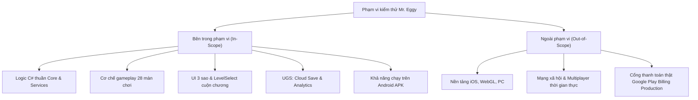
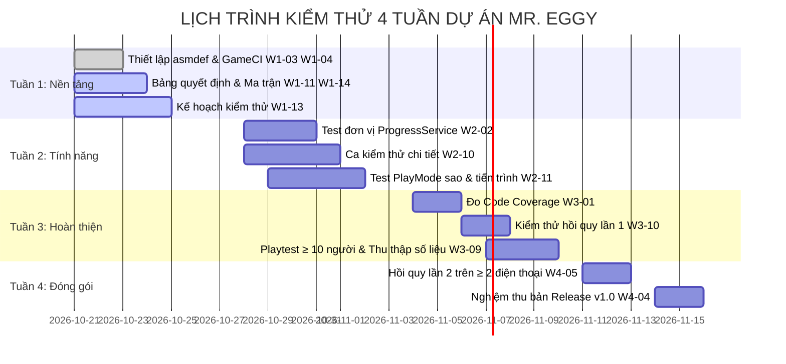

# KẾ HOẠCH KIỂM THỬ PHẦN MỀM (SOFTWARE TEST PLAN)

> **Dự án:** Game giải đố 2D Mr. Eggy  
> **Môn học:** Đồ án chuyên ngành Công nghệ Thông tin (IT6122)  
> **Người thực hiện:** Agent Antigravity (QA Lead)  
> **Phiên bản tài liệu:** 1.0 — Chuẩn hóa theo tiêu chuẩn IEEE 829

---

## 1. Tổng quan & Mục tiêu kiểm thử

### 1.1. Bối cảnh dự án
"Mr. Eggy" là một trò chơi giải đố 2D phong cách "troll" và tư duy phi truyền thống (brain puzzle) được phát triển trên nền tảng **Unity `6000.6.6f1` (C#)**. Dự án được nâng cấp từ một phiên bản ban đầu còn hạn chế về kiến trúc và tính năng, nhằm mở rộng thêm 2 chương mới (Level 21–28), tích hợp hệ thống lưu trữ đám mây (Cloud Save), thu thập dữ liệu phân tích hành vi người chơi (Game Analytics) và hệ sinh thái đánh giá thành tích 3 sao.

### 1.2. Mục tiêu kiểm thử
- Đảm bảo tính đúng đắn và độ tin cậy của các thuật toán lõi (tính sao, gộp tiến trình đám mây, mở khóa màn chơi).
- Đảm bảo tính ổn định của trò chơi khi vận hành trên thiết bị di động Android thực tế (không crash, không rò rỉ bộ nhớ, duy trì tốc độ khung hình ≥ 30–60 FPS).
- Đảm bảo toàn vẹn dữ liệu người chơi khi xảy ra sự cố mạng (offline, rớt mạng giữa chừng, đổi thiết bị).
- Đạt chỉ tiêu chất lượng (KPI đồ án): **100% test tự động pass**, độ bao phủ mã nguồn (Code Coverage) đạt trên **30%–50%**, và **0 lỗi nghiêm trọng (Critical/High)** khi phát hành phiên bản Release v1.0.

---

## 2. Phạm vi kiểm thử (Test Scope)



### 2.1. Trong phạm vi (In-Scope)
- **Tầng Core & Services:** `StarCalculator`, `ProgressData`, `ProgressMerger`, `LevelSession`, `LevelNaming`, `ProgressService`, `HintService`, `LocalProgressStore`.
- **Tầng Gameplay & Cơ chế:** Toàn bộ 28 màn chơi (Level 1 → Level 28), bao gồm các cơ chế vật lý: điều khiển nhảy, Triple Jump, kéo thả địa hình/nút bấm, bẫy rơi, cầu xoay bập bênh, nhân bản clone thí mạng, cờ khóa và cờ giả.
- **Tầng Giao diện người dùng (UI/UX):** Bảng chiến thắng WinPanel với cụm 3 sao (`StarDisplay`), màn hình chọn màn `LevelSelect` với thanh chọn 7 chương, popup gợi ý (Hint Canvas 1 & 2), popup tạm dừng (Pause), giao diện Shop VIP.
- **Dịch vụ Online:** Đăng nhập ẩn danh (Anonymous Authentication), đồng bộ dữ liệu đám mây (Cloud Save) và ghi nhận 5 sự kiện phân tích (Game Analytics).
- **Hệ điều hành đích:** Android (các phiên bản từ Android 10 đến Android 14) trên các tỷ lệ màn hình phổ biến (16:9, 19.5:9, 20:9 có tai thỏ / đục lỗ).

### 2.2. Ngoài phạm vi (Out-of-Scope)
- Nền tảng iOS, máy tính để bàn (PC/Mac) và trình duyệt WebGL.
- Mạng quảng cáo thực tế qua Mediation (trong đồ án sử dụng quảng cáo giả lập đếm ngược qua `AdManager`).
- Hệ thống thanh toán Google Play Billing thật với thẻ tín dụng thực tế (dùng môi trường Sandbox / mô phỏng mã QR).
- Tính năng nhiều người chơi (Multiplayer) thời gian thực.

---

## 3. Chiến lược kiểm thử theo cấp độ (Testing Strategy)

Quy trình kiểm thử được tổ chức theo mô hình Kim tự tháp kiểm thử 4 cấp độ:

| Cấp độ | Loại kiểm thử | Công cụ thực hiện | Trách nhiệm | Phạm vi & Tiêu chí |
|---|---|---|---|---|
| **Cấp 1** | **Unit Testing (EditMode)** | Unity Test Framework (NUnit) trong Unity Editor | Claude Code & Antigravity | Kiểm tra các lớp C# độc lập trong `Scripts/Core/` và `Scripts/Services/` (không phụ thuộc MonoBehaviour). Tốc độ chạy cực nhanh (< 2 giây cho toàn bộ suite). |
| **Cấp 2** | **Integration Testing (PlayMode)** | Unity Test Framework (PlayMode Runner) | Antigravity | Kiểm tra sự tương tác giữa các GameObject, vòng đời MonoBehaviour, cơ chế vật lý 2D, coroutine thời gian thực và sự kiện UI. |
| **Cấp 3** | **System & Performance Testing** | Android Debug Bridge (ADB), Unity Profiler, GameCI | Người dùng & Antigravity | Kiểm thử toàn diện trên file APK cài trực tiếp vào điện thoại thật: tương thích SafeArea, tải scene, mượt mà khi cuộn chương, chịu lỗi khi mất kết nối mạng. |
| **Cấp 4** | **Acceptance Testing (Playtest)** | Khảo sát Google Form + Unity Analytics Dashboard | Người dùng & Antigravity | Thu thập phản hồi từ ≥ 10 người chơi thật để đánh giá độ khó, phát hiện các màn "nút thắt" và trải nghiệm giải đố. |

---

## 4. Kỹ thuật thiết kế ca kiểm thử hộp đen áp dụng

Để đảm bảo phát hiện lỗi tối đa với số lượng ca kiểm thử tối ưu, các kỹ thuật kiểm thử hộp đen chuẩn quốc tế được áp dụng xuyên suốt:

1. **Bảng quyết định (Decision Table Testing):**
   - Áp dụng triệt để cho các logic có nhiều điều kiện kết hợp: Luật tính 3 sao kết thúc màn (`StarCalculator`), Điều kiện mở gợi ý trực tiếp không qua Ads (`HintService`), Luật gộp dữ liệu Local/Cloud (`ProgressMerger`).
   - Chi tiết đã được đặc tả tại tài liệu [`docs/BANG_QUYET_DINH.md`](file:///D:/Repo/MrEggy-antigravity/docs/BANG_QUYET_DINH.md).
2. **Phân vùng tương đương (Equivalence Partitioning):**
   - Phân chia miền dữ liệu đầu vào thành các lớp hợp lệ và không hợp lệ:
     - Số lần chết: `{deaths = 0}` (Hợp lệ, có sao), `{deaths > 0}` (Hợp lệ, mất sao), `{deaths < 0}` (Bất thường, ép về 0).
     - Số level: `{1 <= id <= 28}` (Màn hợp lệ trong game), `{id <= 0 hoặc id > 28}` (Màn ngoài phạm vi).
3. **Phân tích giá trị biên (Boundary Value Analysis):**
   - Tập trung vào các điểm nhạy cảm: `deaths = 0` vs `deaths = 1` (ranh giới giữa 3 sao và 2 sao); số lần nhảy `jumpCount = 3` vs `jumpCount = 4` (ranh giới khóa Triple Jump); cấp độ mở khóa `maxUnlockedLevel` và `maxUnlockedLevel + 1`.
4. **Kiểm thử chuyển trạng thái (State Transition Testing):**
   - Kiểm tra chu trình sống của màn chơi: `Chờ -> Đang chơi -> Tạm dừng (Pause) -> Xem gợi ý -> Chết (nạp lại scene giữ nguyên bộ đếm) -> Thắng màn (khóa tương tác, hiện WinPanel)`.
   - Kiểm tra trạng thái nút màn chơi: `Khóa (Locked) -> Mở khóa (Unlocked) -> Đã hoàn thành (Completed)`.
5. **Kiểm thử chịu lỗi & Dự đoán lỗi (Error Guessing & Fault Injection):**
   - Ngắt kết nối mạng ngay thời điểm chạm cờ chiến thắng; nhập dữ liệu JSON lưu trữ bị rách/hỏng định dạng; bấm nút liên tục với tốc độ cao (Monkey Testing).

---

## 5. Môi trường kiểm thử (Test Environments)

### 5.1. Môi trường cục bộ (Local Development)
- **Engine:** Unity `6000.6.6f1` (Silicon/Windows 64-bit).
- **Trình chạy test:** Unity Test Runner (Menu: `Window -> General -> Test Runner`).
- **Chế độ kiểm tra:** Chạy tự động cả hai tab **EditMode** và **PlayMode**.

### 5.2. Môi trường CI/CD (GitHub Actions)
- **Hệ thống:** GitHub Actions kết hợp bộ action GameCI (`game-ci/unity-test-runner@v4`).
- **Môi trường ảo:** Docker container chính thức từ UnityCI (`unityci/editor:6000.6.6f1-android-3`).
- **Kích hoạt (Trigger):** Tự động kích hoạt khi có Pull Request vào nhánh `main` hoặc push commit mới. Yêu cầu toàn bộ test pass 100% mới cho phép merge.

### 5.3. Môi trường thiết bị di động thật (Hardware Testbed)
Để loại trừ hiện tượng "chạy tốt trên máy dev nhưng lỗi trên máy người dùng", nhóm kiểm thử trên tối thiểu 2 thiết bị Android với thông số khác biệt:

| Thiết bị kiểm thử | Hệ điều hành | Độ phân giải & Tỷ lệ | Kiểu màn hình | Mục tiêu kiểm thử đặc thù |
|---|---|---|---|---|
| **Thiết bị A (Tầm trung)** | Android 11 / 12 | Full HD+ (1080 x 2400) · **20:9** | Đục lỗ (Punch-hole) | Kiểm tra `SafeAreaPanel`, đảm bảo nút Pause/Hint không bị camera đục lỗ che khuất. |
| **Thiết bị B (Tiêu chuẩn)** | Android 10 / 13 | Full HD (1080 x 1920) · **16:9** | Màn hình phẳng truyền thống | Kiểm tra tỷ lệ khung hình cơ bản, không bị kéo dãn sprite hoặc méo nút UI. |

---

## 6. Tiêu chí đạt / dừng kiểm thử

### 6.1. Tiêu chí Đạt (Pass Criteria)
- 100% các bài test tự động trong `Tests_EditMode` và `Tests_PlayMode` chạy thành công (màu xanh).
- Tỷ lệ bao phủ mã nguồn (Code Coverage) của package lõi `MainGameScripts` đạt tối thiểu **30%** (khuyến khích ≥ 50%).
- Toàn bộ các ca kiểm thử thủ công mức `High` và `Critical` trong [`docs/CA_KIEM_THU.md`](file:///D:/Repo/MrEggy-antigravity/docs/CA_KIEM_THU.md) đều đạt trạng thái **PASS**.
- Không có hiện tượng giật lag, tốc độ khung hình trung bình trên thiết bị Android ≥ 30 FPS.

### 6.2. Tiêu chí Tạm dừng (Suspension Criteria)
Quá trình kiểm thử sẽ bị tạm dừng và trả về cho lập trình viên xử lý khẩn cấp khi:
- Bản build APK bị crash ngay khi mở ứng dụng (Crash on launch).
- Lỗi biên dịch (Compile Error) làm đỏ Unity Console hoặc hỏng file asmdef.
- Lỗi làm mất toàn bộ dữ liệu tiến trình người chơi mỗi khi thoát game.

### 6.3. Tiêu chí Khôi phục (Resumption Criteria)
Kiểm thử được tiếp tục sau khi lập trình viên đã tạo bản vá (fix bug), được review độc lập và kiểm tra khói (Smoke Test) vượt qua.

---

## 7. Quy trình quản lý và Phân loại mức độ lỗi (Bug Severity)

Mọi lỗi phát hiện trong quá trình kiểm thử được ghi nhận lên **GitHub Issues** và phân loại theo 4 cấp độ nghiêm trọng:

```
[Mức độ lỗi]
├── 🔴 Critical (Khẩn cấp): Crash app, mất sạch tiến trình, không thể mở màn tiếp theo.
├── 🟠 High (Cao): Tính sai sao, kẹt nhân vật không thể thắng màn, lỗi đồng bộ cloud.
├── 🟡 Medium (Trung bình): Sai lệch vị trí UI nhẹ, nút bấm không nhạy, âm thanh trễ nhịp.
└── 🟢 Low (Thấp): Lỗi chính tả tiếng Việt trong bảng Hint, màu sắc icon lệch tông.
```

- **Tiêu chí xuất xưởng bản Release v1.0:** Bắt buộc **0 lỗi Critical** và **0 lỗi High** còn tồn đọng.

---

## 8. Lịch trình kiểm thử chi tiết theo 4 tuần



---

## 9. Quản lý rủi ro kiểm thử và Phương án phòng ngừa

| # | Rủi ro tiềm ẩn | Khả năng | Tác động | Phương án kiểm soát & Dự phòng |
|:---:|---|:---:|:---:|---|
| **R1** | GitHub Actions GameCI chạy thất bại do thiếu License Unity | Cao | Trung bình | Duy trì chạy toàn bộ bài test cục bộ trong Unity Test Runner; chụp ảnh báo cáo đính kèm; tài liệu hóa rõ ràng trong báo cáo. |
| **R2** | Môi trường Test Runner PlayMode không mô phỏng chính xác va chạm vật lý 2D | Trung bình | Cao | Thêm các lệnh chờ frame vật lý `WaitForFixedUpdate()`; sử dụng `Physics2D.Simulate()` trong kịch bản test; đối chiếu lại bằng kiểm thử trên APK thật. |
| **R3** | Các màn chơi mới được thiết kế quá khó hoặc gây ức chế tiêu cực | Cao | Cao | Triển khai sớm đợt Playtest tuần 3; theo dõi sát sao chỉ số `player_death` và `level_skip` trên Analytics Dashboard để kịp thời điều chỉnh tọa độ bẫy. |
| **R4** | Xung đột file Scene/Prefab khi nhiều người cùng sửa | Cao | Trung bình | Tuân thủ nghiêm ngặt quy tắc khóa Scene (`LevelSelect.unity` chỉ 1 người sửa tại một thời điểm); tạo màn mới 100% bằng tool tự động `CreateNewLevelTool`. |
