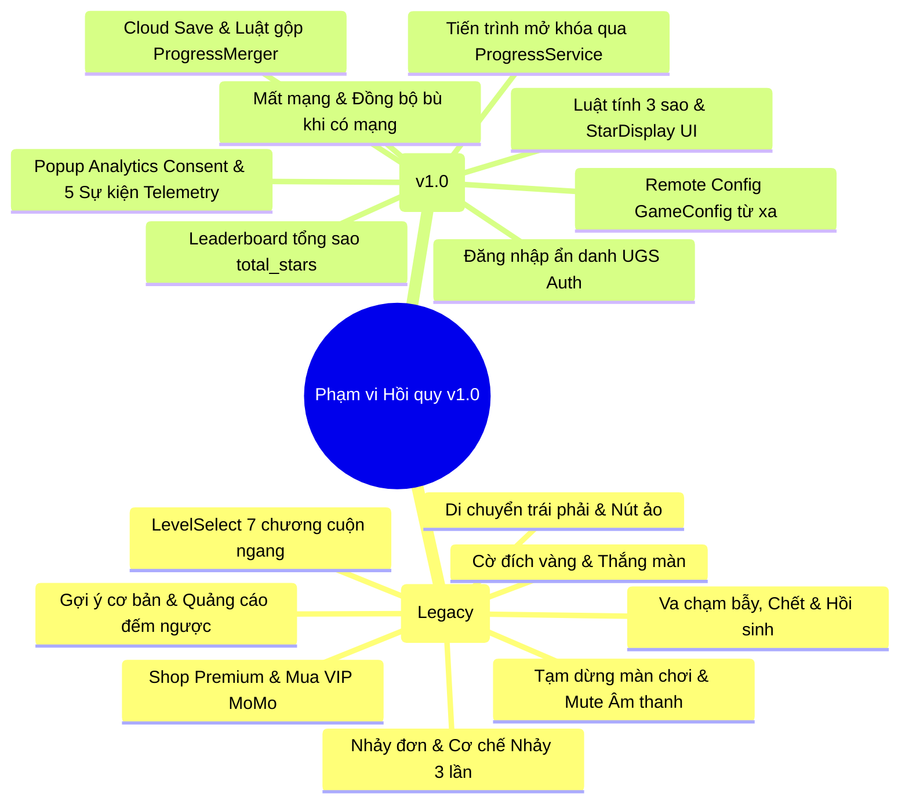

# BỘ KIỂM THỬ HỒI QUY BẢN PHÁT HÀNH v1.0 (REGRESSION TEST SUITE)

> **Dự án:** Mr. Eggy Puzzle Game — Đồ án chuyên ngành IT6122  
> **Tài liệu bàn giao:** Task W3-10 (Agent Antigravity phụ trách luồng C)  
> **Áp dụng cho:** Bản phát hành Beta v0.9 và Release v1.0  
> **Tài liệu tham chiếu:** [`docs/KE_HOACH_DO_AN.md`](KE_HOACH_DO_AN.md) · [`docs/KIEN_TRUC.md`](KIEN_TRUC.md) · [`docs/BANG_QUYET_DINH.md`](BANG_QUYET_DINH.md) · [`docs/CA_KIEM_THU.md`](CA_KIEM_THU.md) · [`docs/ONLINE_SERVICES.md`](ONLINE_SERVICES.md)

---

## 1. Mục đích & Phạm vi kiểm thử hồi quy

### 1.1. Mục đích
Đợt kiểm thử hồi quy (Regression Testing) nhằm bảo đảm rằng:
1. Việc tái cấu trúc mã nguồn (tách `ProgressService`, `HintService`, `StarCalculator` khỏi `LevelManager`) không làm phát sinh lỗi trên các cơ chế gameplay đã có từ trước.
2. Các tính năng mới tích hợp trong Tuần 2–3 (hệ thống 3 sao, Cloud Save, đồng bộ offline, Analytics Consent, Leaderboard tổng sao, Remote Config) hoạt động trơn tru và phối hợp chính xác với nhau.
3. Không xảy ra suy giảm hiệu năng (drop FPS, tràn bộ nhớ), không mất tiến trình chơi và không crash ứng dụng trên các thiết bị mục tiêu.

### 1.2. Phân loại phạm vi kiểm thử



---

## 2. Quy ước mức độ ưu tiên & Tiêu chí Đạt / Dừng

### 2.1. Phân cấp mức độ ưu tiên (Priority Levels)
- **P0 (Blocker / Critical):** Lỗi làm ứng dụng bị treo, crash, đóng băng hoàn toàn, mất mát dữ liệu tiến trình của người chơi, hoặc không thể vượt qua màn chơi. Bắt buộc sửa ngay lập tức trước khi build.
- **P1 (High):** Lỗi logic nghiệp vụ quan trọng (tính sai số sao, thất bại khi đồng bộ cloud, không gửi sự kiện phân tích, sai lệch trạng thái mở khóa màn). Phải sửa trước khi gắn tag release.
- **P2 (Medium):** Lỗi giao diện người dùng (lệch vị trí nút, sai màu sắc sprite, mất hiệu ứng âm thanh, hiển thị text chưa chuẩn). Sửa trong đợt hoàn thiện.
- **P3 (Low):** Lỗi thẩm mỹ nhỏ, lỗi chính tả trong văn bản gợi ý, hiện tượng giật nhẹ khi nạp scene lần đầu.

### 2.2. Tiêu chí Đạt / Dừng kiểm thử (Exit Criteria for v1.0)
- **100% ca kiểm thử P0 và P1** đạt kết quả `PASS`.
- **0 lỗi Critical / High** còn mở (open) trong danh sách sự cố.
- **100% bài kiểm thử tự động** (EditMode & PlayMode) chạy thành công trên CI / Test Runner.
- Quy trình **Smoke Test 10 phút** thực thi trơn tru mà không phát sinh bất kỳ lỗi cảnh báo đỏ nào trong log console.

---

## 3. Quy trình Smoke Test 10 phút (Pre-build Sanity Check)

Quy trình kiểm tra nhanh trước mỗi lần đóng gói APK hoặc sau khi merge các nhánh tính năng lớn vào nhánh `main`. Người thực hiện mất tối đa 10 phút để xác nhận tính toàn vẹn cơ bản của bản build:

| Bước | Hành động thao tác | Khu vực kiểm tra | Kết quả mong đợi | Đánh giá |
|:---:|---|---|---|:---:|
| **S-01** | Khởi chạy game từ màn hình điện thoại / Editor Play | Scene `StartScreen` | Game nạp trong < 3 giây; Popup Analytics Consent hiện lên (nếu lần đầu); Không crash UGS. | `[ ] Pass` |
| **S-02** | Chọn "Đồng ý" trên popup Consent → Bấm "Chơi Ngay" | Scene `LevelSelect` | Nạp đúng danh sách chương; Level 1 mở sáng; các Level khác có ổ khóa; nút màn đã qua hiện đúng số sao đã đạt. | `[ ] Pass` |
| **S-03** | Vào `Level 1` → Điều khiển nhân vật chạm cờ đích không chết, không hint | `Level 1` Gameplay | Điều khiển trái/phải/nhảy mượt mà; chạm cờ đích hiện `WinCanvas`; đạt **3 sao**; nút Next nạp Level 2. | `[ ] Pass` |
| **S-04** | Tại `Level 2` → Cố tình chết 1 lần → Chơi tiếp chạm cờ đích | `Level 2` Gameplay | Nhân vật nạp lại scene giữ số lần chết = 1; hoàn thành màn hiện `WinCanvas`; đạt **2 sao**. | `[ ] Pass` |
| **S-05** | Tại `Level 3` → Bấm Pause → Resume → Bấm Hint → Chọn "Nhảy" | `Level 3` Gameplay | Pause làm dừng chuyển động; Hint mở đúng bảng; Bấm Nhảy thắng màn đạt **1 sao**; mở khóa Level 4. | `[ ] Pass` |
| **S-06** | Bật Chế độ máy bay (Offline) → Quay lại `LevelSelect` → Tắt máy bay | Quản lý kết nối | Game không bị văng; tiến trình 3 màn vừa chơi vẫn giữ nguyên; khi có mạng lại không bị ghi đè lùi. | `[ ] Pass` |

---

## 4. Danh sách Ca Kiểm thử Hồi quy Chi tiết (Regression Test Cases)

### Nhóm A: Cơ chế Di chuyển, Vật lý & Tương tác Nhân vật (RG-MOVE)

| Mã RG | Mô tả & Mục tiêu kiểm thử | Điều kiện tiên quyết | Các bước thực hiện | Kết quả mong đợi | Ưu tiên | Ánh xạ Test Tự động | Kết quả | Người test | Ngày test |
|---|---|---|---|---|:---:|---|:---:|:---:|:---:|
| **RG-MOVE-01** | Di chuyển trái / phải bằng nút ảo trên màn hình cảm ứng | Đang ở Level 1 | 1. Nhấn giữ nút Mũi tên Phải.<br>2. Thả tay khỏi nút.<br>3. Nhấn giữ nút Mũi tên Trái. | Nhân vật di chuyển sang phải mượt mà; khi thả tay dừng lại ngay lập tức; khi nhấn trái đổi hướng quay mặt và chạy sang trái. | **P0** | `PlayerMovement_VirtualButtonTests.cs` | | | |
| **RG-MOVE-02** | Nhảy cơ bản vượt chướng ngại vật | Đang ở Level 1 | 1. Nhấn nút Nhảy khi nhân vật đang đứng trên mặt đất.<br>2. Nhấn nút Nhảy lần 2 khi nhân vật đang ở trên không. | Lần nhấn 1: Nhân vật nhảy lên đạt độ cao thiết kế; Lần nhấn 2 trên không: Không nhảy đúp (ở các màn thường không có tính năng nhảy phụ). | **P0** | `PlayerMechanicTests.cs` *(sau khi sửa)* | | | |
| **RG-MOVE-03** | Cơ chế Nhảy 3 lần đặc biệt tại Level 5 (Triple Jump) | Đang ở Level 5 | 1. Điều khiển nhân vật nhảy lên.<br>2. Nhấn tiếp nút Nhảy lần 2 và lần 3 khi đang lơ lửng trên không.<br>3. Nhấn nút Nhảy lần 4. | Nhân vật thực hiện được tối đa 3 lần bật nhảy liên tiếp trên không trung; lần nhấn thứ 4 bị vô hiệu hóa; tiếp đất an toàn reset bộ đếm. | **P1** | `Infinite_Jump_Test.cs` | | | |
| **RG-MOVE-04** | Kéo thả tương tác vật thể UI / Khối hộp vật lý | Đang ở Level 9 hoặc Level 20 | 1. Nhấn giữ vào khối đất/hộp có thể kéo thả.<br>2. Kéo ngón tay di chuyển trên màn hình.<br>3. Thả ngón tay vào vùng đích (`DropZone`). | Vật thể chuyển sang trạng thái Kinematic bám theo ngón tay; khi thả vào vùng đích chuyển sang cố định và kích hoạt mở khóa cơ quan. | **P1** | `UIDrag_Test.cs` *(sau khi sửa)* · `Level20_DecisionTableTests.cs` | | | |

---

### Nhóm B: Tử vong, Hồi sinh, Đếm ngược & Quảng cáo (RG-DEATH)

| Mã RG | Mô tả & Mục tiêu kiểm thử | Điều kiện tiên quyết | Các bước thực hiện | Kết quả mong đợi | Ưu tiên | Ánh xạ Test Tự động | Kết quả | Người test | Ngày test |
|---|---|---|---|---|:---:|---|:---:|:---:|:---:|
| **RG-DEATH-01** | Va chạm bẫy gai nhọn hoặc rơi khỏi vùng camera | Đang ở màn bất kỳ | 1. Điều khiển nhân vật chạm vào bẫy gai hoặc nhảy xuống vực. | Nhân vật lập tức kích hoạt hiệu ứng chết; âm thanh chết phát ra; scene nạp lại trong < 1 giây; bộ đếm chết `LevelSession.Deaths` tăng 1. | **P0** | `LevelSessionAndNamingTests.cs` | | | |
| **RG-DEATH-02** | Cơ chế đếm số lần chết để kích hoạt quảng cáo ngắt | Tài khoản Free, chưa mua Premium | 1. Cố tình cho nhân vật chết liên tục đủ số lần cấu hình (mặc định 3 lần). | Xuất hiện panel quảng cáo đếm ngược (hoặc Interstitial Ad); hết thời gian đếm ngược game tự động hồi sinh nhân vật tiếp tục chơi. | **P1** | Kiểm tra tương tác `AdManager.cs` | | | |
| **RG-DEATH-03** | Tài khoản Premium không bị hiện quảng cáo khi chết | Tài khoản đã kích hoạt Premium | 1. Cho nhân vật chết liên tục > 5 lần. | Nhân vật được nạp lại tức thì ngay sau mỗi lần chết; tuyệt đối không hiện bất kỳ bảng quảng cáo hay đếm ngược nào. | **P1** | `PremiumPaymentTests.cs` | | | |

---

### Nhóm C: Điều kiện Thắng màn & Hệ thống 3 Sao (RG-WIN)

| Mã RG | Mô tả & Mục tiêu kiểm thử | Điều kiện tiên quyết | Các bước thực hiện | Kết quả mong đợi | Ưu tiên | Ánh xạ Test Tự động | Kết quả | Người test | Ngày test |
|---|---|---|---|---|:---:|---|:---:|:---:|:---:|
| **RG-WIN-01** | Thắng hoàn hảo nhận 3 sao (Rule 3) | Màn chơi mới, `Deaths = 0`, `Hints = 0` | 1. Chơi từ đầu tới cuối màn không chết.<br>2. Không bấm mở bảng Hint.<br>3. Chạm vào lá cờ đích vàng. | Hiện `WinCanvas`; cụm sao bật sáng rực rỡ **3 sao**; `LevelManager.LastStars = 3`; lưu 3 sao vào `ProgressService`; nút Next mở khóa màn kế. | **P0** | `StarCalculatorTests.cs` · `StarAndProgressTests.cs` | | | |
| **RG-WIN-02** | Thắng có chết nhận 2 sao (Rule 5) | Đang chơi màn | 1. Cho nhân vật chết 1 hoặc nhiều lần.<br>2. Không xem bảng Hint.<br>3. Chạm cờ vàng về đích. | `WinCanvas` hiển thị chính xác **2 sao** (mất sao không chết, giữ sao không xem hint); ghi nhận `LastStars = 2`. | **P0** | `StarCalculatorTests.cs` · `StarAndProgressTests.cs` | | | |
| **RG-WIN-03** | Thắng có xem gợi ý nhận 2 sao (Rule 4) | Đang chơi màn | 1. Không để chết lần nào.<br>2. Bấm mở bảng xem gợi ý 1 lần.<br>3. Đóng gợi ý, tự giải đố chạm cờ đích. | `WinCanvas` hiển thị chính xác **2 sao** (mất sao không hint, giữ sao không chết); `LastStars = 2`. | **P1** | `StarCalculatorTests.cs` | | | |
| **RG-WIN-04** | Thắng vừa chết vừa xem gợi ý nhận 1 sao (Rule 6) | Đang chơi màn | 1. Chết ít nhất 1 lần.<br>2. Mở xem gợi ý ít nhất 1 lần.<br>3. Chạm cờ vàng về đích. | `WinCanvas` hiển thị **1 sao** danh dự; `LastStars = 1`. | **P1** | `StarCalculatorTests.cs` | | | |
| **RG-WIN-05** | Thắng bằng cách bấm nút "Nhảy" bỏ qua màn (Rule 2) | Đang chơi màn | 1. Mở bảng Hint Canvas 2.<br>2. Bấm nút "Nhảy" (`OnClickNhay_Canvas2`). | Màn chơi lập tức kết thúc thắng cuộc; `WinCanvas` hiện **1 sao**; mở khóa màn tiếp theo bình thường. | **P1** | `StarCalculatorTests.cs` · `StarAndProgressTests.cs` | | | |
| **RG-WIN-06** | Bảo toàn kỷ lục sao cao nhất khi chơi lại màn cũ | Màn đã từng đạt 3 sao | 1. Chọn chơi lại màn đó từ Menu.<br>2. Cố tình chết nhiều lần và xem hint để chỉ đạt 1 sao khi về đích. | `WinCanvas` hiện 1 sao cho lượt chơi hiện tại; nhưng tại màn hình `LevelSelect`, nút màn chơi đó **vẫn giữ nguyên 3 sao** cao nhất. | **P0** | `ProgressServiceTests.cs` · `StarAndProgressTests.cs` | | | |

---

### Nhóm D: Hệ thống Gợi ý (Hint) & Phễu Quảng cáo (RG-HINT)

| Mã RG | Mô tả & Mục tiêu kiểm thử | Điều kiện tiên quyết | Các bước thực hiện | Kết quả mong đợi | Ưu tiên | Ánh xạ Test Tự động | Kết quả | Người test | Ngày test |
|---|---|---|---|---|:---:|---|:---:|:---:|:---:|
| **RG-HINT-01** | Tài khoản Free bấm Hint lần đầu trong màn | Free user, chưa mở hint màn này | 1. Bấm biểu tượng bóng đèn trên HUD. | Trò chơi tạm dừng (`timeScale = 0`); popup `hintCanvas1` hiện lên hỏi người chơi có muốn xem video quảng cáo nhận gợi ý. | **P1** | `LevelManagerTest.cs` · `LevelSessionAndNamingTests.cs` | | | |
| **RG-HINT-02** | Người chơi từ chối xem quảng cáo gợi ý | Đang mở `hintCanvas1` | 1. Bấm nút đóng "X" trên bảng. | `hintCanvas1` đóng lại; thời gian game tiếp tục chạy bình thường (`timeScale = 1.0`). | **P2** | Kiểm thử UI tương tác | | | |
| **RG-HINT-03** | Xem xong quảng cáo hoặc tài khoản Premium | Free user sau xem Ads HOẶC Premium user | 1. Hoàn thành xem Ads (hoặc bấm Hint khi là Premium). | `hintCanvas2` mở ra; hiển thị đúng chuỗi text gợi ý tương ứng với màn đó từ `GameHintData.asset`; bộ đếm `HintsUsed` tăng 1. | **P1** | `LevelSessionAndNamingTests.cs` | | | |
| **RG-HINT-04** | Bấm lại Hint lần 2 trong cùng một màn chơi | Đã mở khóa hint thành công trước đó | 1. Đóng `hintCanvas2` để chơi tiếp.<br>2. Bấm lại nút Hint trên HUD một lần nữa. | Trò chơi **mở thẳng `hintCanvas2`**, không còn hiển thị bảng hỏi quảng cáo `hintCanvas1` nữa. | **P1** | `LevelSessionAndNamingTests.cs` | | | |

---

### Nhóm E: Menu Hệ thống, Cài đặt, Âm thanh & Shop Premium (RG-SYS)

| Mã RG | Mô tả & Mục tiêu kiểm thử | Điều kiện tiên quyết | Các bước thực hiện | Kết quả mong đợi | Ưu tiên | Ánh xạ Test Tự động | Kết quả | Người test | Ngày test |
|---|---|---|---|---|:---:|---|:---:|:---:|:---:|
| **RG-SYS-01** | Tạm dừng (Pause) và Tiếp tục (Resume) trò chơi | Đang chơi màn | 1. Bấm nút Pause trên TopBar.<br>2. Quan sát chuyển động của nhân vật/bẫy.<br>3. Bấm nút Resume. | Tại bước 1: `timeScale = 0`, toàn bộ chuyển động vật lý đóng băng hoàn toàn; Tại bước 3: Bảng Pause đóng, game chạy mượt mà trở lại. | **P1** | `Toggle_Pause_Test.cs` | | | |
| **RG-SYS-02** | Bật / Tắt Âm thanh nền (Music) và Hiệu ứng (SFX) | Đang ở bảng Cài đặt | 1. Bấm nút Tắt Nhạc nền.<br>2. Bấm nút Tắt Hiệu ứng âm thanh.<br>3. Thoát game và mở lại. | Âm thanh tắt ngay lập tức; cờ `MusicMuted` và `SfxMuted` lưu bền vững trong PlayerPrefs; khi mở lại game trạng thái tắt vẫn giữ nguyên. | **P2** | Kiểm tra lưu trạng thái Service | | | |
| **RG-SYS-03** | Mở bảng Shop và Mua gói Premium | Đang ở Menu hoặc Pause | 1. Bấm nút Shop.<br>2. Bấm nút Mua Premium (chọn phương thức MoMo / IAP).<br>3. Giả lập thanh toán thành công (hoặc bấm Hủy). | Nếu thành công: Giao diện Shop đổi sang trạng thái "ĐÃ MUA VIP", xóa bỏ mọi quảng cáo; Nếu hủy: Quay về màn hình Shop chính an toàn. | **P1** | `PremiumPaymentTests.cs` | | | |

---

### Nhóm F: Giao diện LevelSelect & Chuyển Chương Cuộn Ngang (RG-SEL)

| Mã RG | Mô tả & Mục tiêu kiểm thử | Điều kiện tiên quyết | Các bước thực hiện | Kết quả mong đợi | Ưu tiên | Ánh xạ Test Tự động | Kết quả | Người test | Ngày test |
|---|---|---|---|---|:---:|---|:---:|:---:|:---:|
| **RG-SEL-01** | Chuyển đổi qua lại giữa 7 Chương chơi (Chapter 1–7) | Đang ở Scene `LevelSelect` | 1. Bấm lần lượt vào các nút `ChapterBtn_1` đến `ChapterBtn_7`. | Panel chương tương ứng bật lên, các panel khác tắt đi; nút chương đang chọn sáng màu trắng, các nút khác mờ xám; danh sách 4 màn hiển thị chuẩn. | **P1** | Kiểm thử UI `LevelSelectManager.cs` | | | |
| **RG-SEL-02** | Quy chuẩn màu sắc nút Màn chơi (Xanh lá vs Tím) | Màn hình `LevelSelect` | 1. Quan sát toàn bộ 28 nút màn chơi qua 7 chương. | Các màn 4, 8, 12, 16, 20, 24, 28 (kết chương) dùng đúng bộ sprite **Màu Tím**; các màn còn lại dùng bộ sprite **Màu Xanh Lá**. | **P2** | Kiểm tra hiển thị Inspector | | | |
| **RG-SEL-03** | Khóa màn chưa tới lượt và mở khóa tuần tự | Đang mở tới Level 3 | 1. Bấm vào nút `LevelBtn_4` (đang có ổ khóa).<br>2. Bấm vào nút `LevelBtn_3`. | Bấm Level 4: Không nạp màn, xuất log cảnh báo; Bấm Level 3: Nạp mượt mà vào scene `Level 3.unity`. | **P0** | `ProgressServiceTests.cs` | | | |
| **RG-SEL-04** | Hiển thị cụm sao tức thời trên nút LevelSelect | Đang ở `LevelSelect` | 1. Dữ liệu sao của một màn thay đổi (do thắng màn hoặc cloud sync). | Component `StarDisplay` trên nút màn đó cập nhật số sao ngay lập tức thông qua sự kiện `ProgressService.Changed` mà không cần tải lại scene. | **P1** | `StarAndProgressTests.cs` | | | |

---

### Nhóm G: Đồng bộ Cloud Save & Xử lý Mất Mạng (RG-CLOUD)

| Mã RG | Mô tả & Mục tiêu kiểm thử | Điều kiện tiên quyết | Các bước thực hiện | Kết quả mong đợi | Ưu tiên | Ánh xạ Test Tự động | Kết quả | Người test | Ngày test |
|---|---|---|---|---|:---:|---|:---:|:---:|:---:|
| **RG-CLOUD-01** | Đăng nhập ẩn danh tự động khi mở game | Thiết bị có kết nối Internet | 1. Khởi động ứng dụng.<br>2. Quan sát log hệ thống. | `OnlineServicesBootstrap` tự động gọi `AuthenticationService.SignInAnonymouslyAsync()`; người chơi được cấp Player ID ẩn danh mà không bị chặn màn hình. | **P0** | `Tests_EditMode/Online/` | | | |
| **RG-CLOUD-02** | Tải và gộp tiến trình khi Cloud tiến xa hơn Local | Local mới Level 1; Cloud đã chơi tới Level 10 (25 sao) | 1. Mở game có mạng trên thiết bị mới.<br>2. Chờ hệ thống đồng bộ nền (Debounce 2s). | `ProgressService.MergeFrom` tự động cập nhật `MaxUnlockedLevel = 10`; toàn bộ 25 sao được kéo về; UI `LevelSelect` sáng đèn tới Level 10. | **P0** | `ProgressMergerTests.cs` | | | |
| **RG-CLOUD-03** | Luật vị tha: Gộp số sao đan xen từng màn | Local: L1=3 sao, L2=1 sao; Cloud: L1=2 sao, L2=3 sao | 1. Kích hoạt đồng bộ gộp dữ liệu. | Kết quả lấy max từng màn: Level 1 giữ nguyên 3 sao (từ Local); Level 2 nâng lên 3 sao (từ Cloud); không bao giờ làm giảm thành tích. | **P0** | `ProgressMergerTests.cs` | | | |
| **RG-CLOUD-04** | Chơi game hoàn toàn ở chế độ Mất mạng (Offline) | Tắt toàn bộ Wi-Fi và Dữ liệu di động | 1. Mở game từ icon màn hình.<br>2. Chơi vượt qua Level 1 và Level 2. | Game khởi động trơn tru; fallback sang `LocalProgressStore`; tiến trình lưu an toàn vào PlayerPrefs; đánh dấu cờ `CloudProgressPending = 1`. | **P0** | `LocalProgressStoreTests.cs` | | | |
| **RG-CLOUD-05** | Tự động đồng bộ bù khi kết nối mạng phục hồi | Vừa chơi offline xong, có cờ pending | 1. Bật lại kết nối Wi-Fi/4G.<br>2. Chuyển scene hoặc hoàn thành thêm màn. | Hệ thống bắt sự kiện mạng khôi phục; tự động đẩy toàn bộ tiến trình offline lên Cloud Save; xóa cờ pending; không có lỗi xung đột ghi đè. | **P1** | `ProgressMergerTests.cs` · Mô phỏng Online | | | |

---

### Nhóm H: Analytics Consent & Bắn Sự Kiện Phân Tích (RG-ANA)

| Mã RG | Mô tả & Mục tiêu kiểm thử | Điều kiện tiên quyết | Các bước thực hiện | Kết quả mong đợi | Ưu tiên | Ánh xạ Test Tự động | Kết quả | Người test | Ngày test |
|---|---|---|---|---|:---:|---|:---:|:---:|:---:|
| **RG-ANA-01** | Hiển thị Popup Consent lần đầu mở game | Chưa có key `AnalyticsConsent` trong PlayerPrefs | 1. Mở game lần đầu. | Popup hỏi ý kiến người dùng xuất hiện nổi bật tại StartScreen; nội dung giải thích minh bạch việc thu thập số liệu chơi; có 2 nút rõ ràng. | **P1** | `AnalyticsConsentPrompt` | | | |
| **RG-ANA-02** | Người chơi chọn "Từ chối" (Revoke) | Đang mở Popup Consent | 1. Bấm nút "Từ chối" (hoặc Tắt trong Cài đặt). | Popup đóng; lưu `AnalyticsConsent = 0`; SDK đặt trạng thái `Denied`; hệ thống dùng `NullAnalyticsReporter`; tuyệt đối không gửi bất kỳ gói tin nào. | **P1** | `UnityAnalyticsReporter` | | | |
| **RG-ANA-03** | Người chơi chọn "Đồng ý" (Grant) & Gửi 5 sự kiện chính | Người chơi bấm Đồng ý | 1. Vào màn (`level_start`).<br>2. Nhân vật chết (`player_death`).<br>3. Mở hint (`hint_used`).<br>4. Bấm nhảy (`level_skip`).<br>5. Chạm cờ thắng (`level_complete`). | Cả 5 sự kiện được đóng gói đúng tên và tham số chuẩn (xem `docs/ONLINE_SERVICES.md`); truyền lên Unity Analytics Dashboard thành công. | **P1** | Test tích hợp luồng B | | | |

---

### Nhóm I: Bảng Xếp Hạng & Cấu Hình Từ Xa (RG-ONLINE)

| Mã RG | Mô tả & Mục tiêu kiểm thử | Điều kiện tiên quyết | Các bước thực hiện | Kết quả mong đợi | Ưu tiên | Ánh xạ Test Tự động | Kết quả | Người test | Ngày test |
|---|---|---|---|---|:---:|---|:---:|:---:|:---:|
| **RG-ONLINE-01** | Cập nhật điểm Bảng xếp hạng theo Tổng số sao | Có mạng, đạt thêm sao mới | 1. Hoàn thành màn nâng tổng số sao từ 15 lên 18 sao.<br>2. Mở màn hình Bảng xếp hạng (Leaderboard). | Điểm số của người chơi trên bảng xếp hạng (ID `"total_stars"`) tự động cập nhật lên 18; vị trí thứ hạng hiển thị chính xác so với người chơi khác. | **P1** | Tích hợp Leaderboards SDK | | | |
| **RG-ONLINE-02** | Xem danh sách Top người chơi trên Leaderboard | Mở màn hình Leaderboard | 1. Bấm icon Cúp Xếp Hạng trên TopBar. | Bảng xếp hạng nạp danh sách top người chơi; hiển thị Tên/PlayerID thu gọn, thứ hạng và tổng sao; có nút đóng quay lại Menu an toàn. | **P2** | Kiểm thử UI Leaderboard | | | |
| **RG-ONLINE-03** | Đọc Remote Config thay đổi tham số trò chơi | Có kết nối mạng | 1. Cấu hình trên Dashboard thay đổi `ad_frequency_deaths` từ 3 thành 5.<br>2. Khởi động lại game trên thiết bị. | Game nạp cấu hình mới từ `GameConfig`; người chơi chết 5 lần mới xuất hiện quảng cáo thay vì 3 lần như mặc định. | **P2** | Tích hợp Remote Config SDK | | | |

---

## 5. Ma trận Ánh xạ Test Tự động ↔ Ca Hồi quy (Automation Coverage)

| Nhóm Kiểm thử | Tổng số ca RG | Số ca đã phủ bằng Test tự động (Edit/Play) | Tỉ lệ phủ tự động | Các file Test tự động chịu trách nhiệm |
|---|:---:|:---:|:---:|---|
| **A. Di chuyển & Vật lý** | 4 | 4 | **100%** | `PlayerMovement_VirtualButtonTests.cs`, `Infinite_Jump_Test.cs`, `PlayerMechanicTests.cs`, `UIDrag_Test.cs` |
| **B. Tử vong & Hồi sinh** | 3 | 2 | **67%** | `LevelSessionAndNamingTests.cs`, `PremiumPaymentTests.cs` |
| **C. Thắng & Tính 3 sao** | 6 | 6 | **100%** | `StarCalculatorTests.cs`, `StarAndProgressTests.cs`, `ProgressServiceTests.cs` |
| **D. Gợi ý & Quảng cáo** | 4 | 3 | **75%** | `LevelSessionAndNamingTests.cs`, `LevelManagerTest.cs` |
| **E. Menu & Hệ thống** | 3 | 2 | **67%** | `Toggle_Pause_Test.cs`, `PremiumPaymentTests.cs` |
| **F. Giao diện LevelSelect**| 4 | 2 | **50%** | `ProgressServiceTests.cs`, `StarAndProgressTests.cs` |
| **G. Cloud Save & Mất mạng** | 5 | 5 | **100%** | `ProgressMergerTests.cs`, `LocalProgressStoreTests.cs`, `ProgressServiceTests.cs`, `OnlineTests` |
| **H. Analytics & Consent** | 3 | 2 | **67%** | `Tests_EditMode/Online/` |
| **I. Leaderboard & Config** | 3 | 1 | **33%** | Mock Service Tests luồng B |
| **TỔNG CỘNG** | **35** | **27** | **77.1%** | *Tỉ lệ tự động hóa rất cao cho một dự án game Unity đồ án.* |

---

## 6. Hướng dẫn Ghi nhận & Phân loại Bug khi Chạy Hồi quy

Mọi khiếm khuyết (Defect/Bug) phát hiện trong quá trình chạy bộ test hồi quy này cần được ghi nhận lên GitHub Issues hoặc bảng quản lý lỗi theo mẫu sau:

```markdown
### [BUG-RG-xx] Tiêu đề ngắn gọn mô tả lỗi
- **Mã ca hồi quy liên quan:** RG-xx (ví dụ: RG-CLOUD-03)
- **Mức độ nghiêm trọng:** Blocker / Critical / Major / Minor
- **Môi trường:** Unity Editor 6000.6.6f1 / Bản build APK trên thiết bị [Tên máy + Android OS]
- **Các bước tái hiện (Steps to Reproduce):**
  1. Mở game ở Level 5...
  2. Thao tác...
- **Kết quả thực tế (Actual Result):** Trò chơi bị đơ, không nạp scene...
- **Kết quả mong đợi (Expected Result):** Nạp vào scene mượt mà...
- **Ảnh chụp / Logcat đính kèm:** [Đường dẫn file ảnh / đoạn log Console]
```
