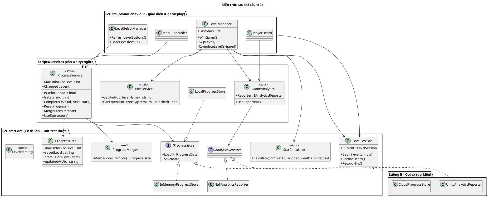
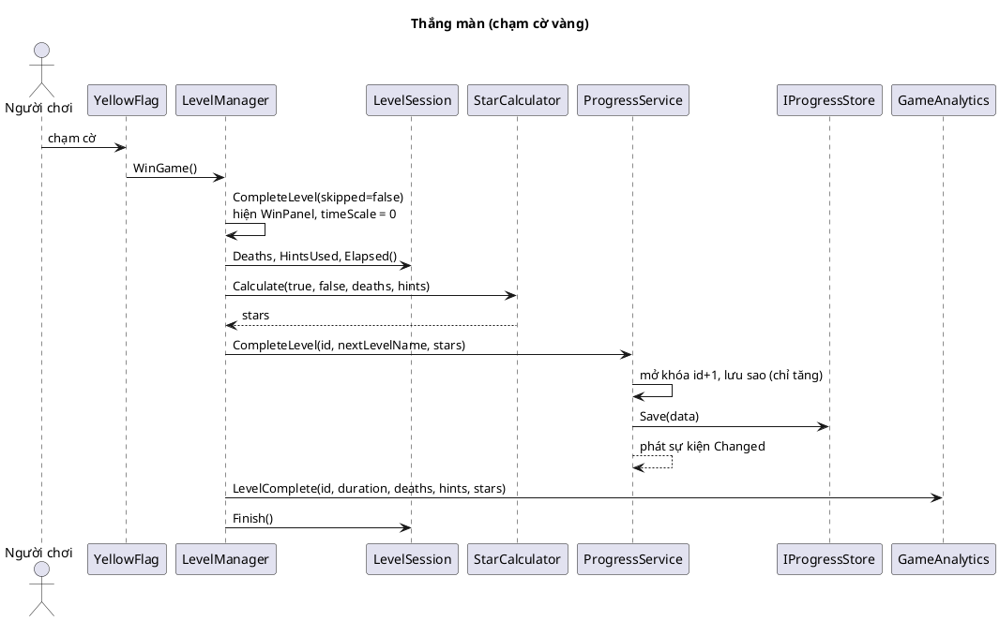
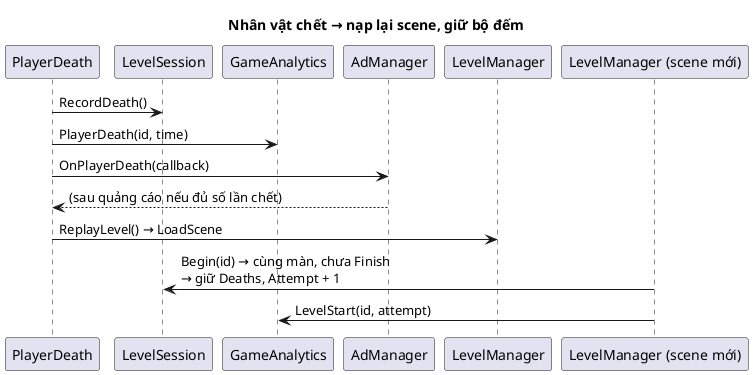
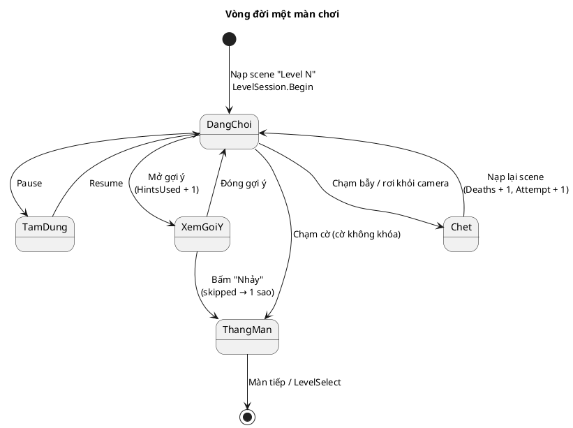

# KIẾN TRÚC MÃ NGUỒN — MR. EGGY

> Task W1-06. Sơ đồ viết bằng PlantUML: dán vào https://www.plantuml.com/plantuml hoặc dùng extension PlantUML của VS Code để xuất ảnh cho báo cáo.

## 1. Kiến trúc TRƯỚC khi tái cấu trúc

`LevelManager` ôm nhiều trách nhiệm; nhiều lớp đọc/ghi thẳng `PlayerPrefs` với key dạng chuỗi rải rác.

```plantuml
@startuml KienTruc_Truoc
skinparam classAttributeIconSize 0
title Kiến trúc trước tái cấu trúc

class LevelManager <<MonoBehaviour>> {
  +levelDatabase : LevelDatabase
  +nextLevelName : string
  +OnClickHintButton()
  +OnClickCo_Canvas1()
  +OnClickNhay_Canvas2()
  +WinGame()
  -GetCurrentLevelNumber() : int
  .. tra cứu hint (LINQ) ..
  .. ghi PlayerPrefs "MaxUnlockedLevel", "SavedLevel" ..
}
class LevelSelectManager <<MonoBehaviour>> {
  +RefreshLevelButtons()
  +LoadLevel(levelId)
  .. đọc PlayerPrefs "MaxUnlockedLevel" ..
}
class MenuController <<MonoBehaviour>> {
  +OnConfirmYesClicked()
  .. ghi PlayerPrefs (reset) ..
}
class PlayerDeath <<MonoBehaviour>>
class PremiumManager <<MonoBehaviour>> {
  +IsPremium : bool
  .. PlayerPrefs "isPremium" ..
}
class AdManager <<MonoBehaviour>>
class LevelDatabase <<ScriptableObject>>
database PlayerPrefs

LevelManager --> LevelDatabase
LevelManager --> PremiumManager
LevelManager --> AdManager
LevelManager --> PlayerPrefs
LevelSelectManager --> PlayerPrefs
MenuController --> PlayerPrefs
PremiumManager --> PlayerPrefs
PlayerDeath --> AdManager
PlayerDeath --> LevelManager : ReplayLevel()
@enduml
```

**Vấn đề:**
- Logic tiến trình trộn với UI → muốn test phải dựng cả GameObject, Canvas.
- Không có chỗ "cắm" Cloud Save hay Analytics mà không sửa nhiều lớp.
- Key PlayerPrefs viết tay ở nhiều nơi → dễ sai chính tả, khó đổi.

## 2. Kiến trúc SAU khi tái cấu trúc



**Nguyên tắc:**
- `Core/` không phụ thuộc MonoBehaviour → test EditMode nhanh, không cần scene.
- Thay nơi lưu (Local → Cloud) hoặc bật Analytics chỉ bằng `ProgressService.UseStore(...)` / `GameAnalytics.UseReporter(...)`, không sửa `LevelManager`.
- Premium **không** nằm trong `ProgressData`: do `PremiumManager` quản lý, Google Play tự khôi phục giao dịch không tiêu hao (non-consumable) → tránh việc dữ liệu tiến trình cũ ghi đè trạng thái vừa mua.

## 3. Sơ đồ tuần tự — Thắng màn



## 4. Sơ đồ tuần tự — Chết và chơi lại



## 5. Sơ đồ trạng thái — Vòng đời một màn


