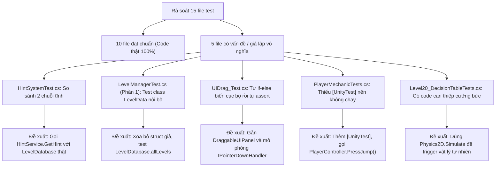

# MA TRẬN TRUY VẾT YÊU CẦU & RÀ SOÁT KIỂM THỬ (TEST TRACEABILITY MATRIX)

> **Dự án:** Mr. Eggy Puzzle Game — Đồ án chuyên ngành IT6122  
> **Thực hiện:** Agent Antigravity (QA & Tài liệu)  
> **Mục tiêu:** Đánh giá chất lượng toàn bộ test suite hiện có, bóc tách các bài test giả/dữ liệu tĩnh, đề xuất phương án cải thiện và thiết lập ma trận truy vết 2 chiều giữa Yêu cầu (Requirements) và Ca kiểm thử (Test Cases).

---

## 1. Rà soát và đánh giá chất lượng toàn bộ các bài test hiện có

Dự án hiện có **15 file test** (6 file EditMode và 9 file PlayMode). Dưới đây là phân tích chi tiết từng file:

### 1.1. Nhóm EditMode (`Assets/_Project/Tests_EditMode/`)

| STT | Tên file test | Các hàm kiểm thử | Đối tượng kiểm tra | Đánh giá tính xác thực | Phân loại & Nhận xét chi tiết |
|:---:|---|---|---|:---:|---|
| 1 | `StarCalculatorTests.cs` | • `Calculate_FollowsDecisionTable` (6 TestCases) • `Calculate_OneDeath_LosesNoDeathStar` • `Calculate_NegativeCounters_TreatedAsZero` • `Calculate_NeverExceedsMaxStars` | [`StarCalculator.cs`](file:///D:/Repo/MrEggy-antigravity/Assets/_Project/Scripts/Core/StarCalculator.cs) | **Code thật 100%** | **Rất tốt.** Kiểm thử vét cạn theo bảng quyết định 3 sao, bao phủ giá trị biên (`deaths = 1`), dữ liệu âm và trần 3 sao. |
| 2 | `ProgressMergerTests.cs` | • `Merge_TakesHigherMaxUnlockedLevel` • `Merge_SavedLevelFollowsSideWithMoreProgress` • `Merge_EqualProgress_KeepsLocalSavedLevel` • `Merge_TakesHigherStarsPerLevel` • `Merge_TakesLaterUpdatedAt` • `Merge_NullSides_ReturnsCopyOfOther` • `Merge_DoesNotModifyInputs` | [`ProgressMerger.cs`](file:///D:/Repo/MrEggy-antigravity/Assets/_Project/Scripts/Core/ProgressMerger.cs) | **Code thật 100%** | **Rất tốt.** Bao phủ toàn bộ các quy tắc gộp dữ liệu local/cloud, kiểm tra tính bất biến (immutability) của dữ liệu đầu vào. |
| 3 | `ProgressServiceTests.cs` | • `NewPlayer_OnlyLevel1Unlocked` • `CompleteLevel_UnlocksNextLevel_AndSaves` • `ReplayingOldLevel_DoesNotLowerMaxUnlocked` • `CompleteLevel_WithFewerStars_KeepsBestStars` • `ResetProgress_BackToLevel1_ClearsStars` • `MergeFrom_AppliesCloudProgress` • `Changed_IsRaisedOnEveryCommit` • `Snapshot_IsACopy` • `UseStore_LoadsExistingDataFromNewStore` | [`ProgressService.cs`](file:///D:/Repo/MrEggy-antigravity/Assets/_Project/Scripts/Services/ProgressService.cs) | **Code thật 100%** | **Rất tốt.** Dùng `InMemoryProgressStore` để cách ly `PlayerPrefs`, kiểm tra sự kiện `Changed`, bảo toàn thành tích cao nhất. |
| 4 | `LocalProgressStoreTests.cs` | • `Load_WhenEmpty_ReturnsDefaults` • `SaveThenLoad_RoundTripsAllFields` • `Load_ReadsLegacyKeys` • `Load_CorruptedStars_FallsBackToEmpty` • `Load_InvalidMaxUnlocked_ClampedTo1` • `Save_DoesNotTouchPremiumKey` | [`LocalProgressStore.cs`](file:///D:/Repo/MrEggy-antigravity/Assets/_Project/Scripts/Services/LocalProgressStore.cs) | **Code thật 100%** | **Rất tốt.** Kiểm tra tương thích dữ liệu cũ (legacy keys), khả năng chịu lỗi khi JSON hỏng, và bảo đảm không chạm key `isPremium`. |
| 5 | `LevelSessionAndNamingTests.cs` | • `Begin_NewLevel_StartsFreshSession` • `Begin_SameLevelAfterDeath_KeepsCounters` • `Begin_AfterFinish_StartsNewSession` • `Begin_DifferentLevel_StartsNewSession` • `Elapsed_NeverNegative` • `TryParseLevelNumber_Cases` • `SceneNameFor_RoundTrips` • `GetHint_ReturnsMessageOfMatchingLevel` • `GetHint_MissingLevelOrDatabase_ReturnsDefault` • `CanOpenHintDirectly_DecisionTable` | [`LevelSession.cs`](file:///D:/Repo/MrEggy-antigravity/Assets/_Project/Scripts/Core/LevelSession.cs) [`LevelNaming.cs`](file:///D:/Repo/MrEggy-antigravity/Assets/_Project/Scripts/Core/LevelNaming.cs) [`HintService.cs`](file:///D:/Repo/MrEggy-antigravity/Assets/_Project/Scripts/Services/HintService.cs) | **Code thật 100%** | **Rất tốt.** Kiểm tra chu trình sống của session khi người chơi chết và nạp lại scene, chuẩn hóa tên màn `Level N` và bảng quyết định mở hint. |
| 6 | `LevelManagerTest.cs` | • `GetLevel_WhenLevelIdInvalid_ReturnsNullSafely` • `Test_ClickHint_PremiumUser_OpensCanvas2Immediately` • `Test_ClickHint_FreeUser_OpensCanvas1First` • `Test_ClickNhay_PremiumUser_WinsGameImmediately` • `Test_ClickNhay_FreeUser_FreezesTimeScaleForAds` | `LevelData` (cục bộ) và [`LevelManager.cs`](file:///D:/Repo/MrEggy-antigravity/Assets/_Project/Scripts/LevelManager.cs) | ⚠ **Hỗn hợp** (Phần 1: Giả; Phần 2: Thật) | 🔴 **PHÁT HIỆN LỖI:** Phần 1 (dòng 13–32) tự khai báo `class LevelData` cục bộ trong file test, tạo một `List<LevelData>` giả rồi `FirstOrDefault`. **Hoàn toàn không test bất kỳ code nào của game!** Phần 2 test code thật của `LevelManager`. |

---

### 1.2. Nhóm PlayMode (`Assets/_Project/Tests_PlayMode/`)

| STT | Tên file test | Các hàm kiểm thử | Đối tượng kiểm tra | Đánh giá tính xác thực | Phân loại & Nhận xét chi tiết |
|:---:|---|---|---|:---:|---|
| 7 | `HintSystemTest.cs` | • `HintSystem_ShowHint_DisplaysCorrectText` | Không có (chỉ có 2 chuỗi string) | ❌ **DỮ LIỆU GIẢ 100% (VÔ NGHĨA)** | 🔴 **LỖI NGHIÊM TRỌNG:** Gán `actualHint = "Sức người có hạn..."` rồi `Assert.AreEqual(expectedHint, actualHint)`. Không gọi `HintService`, không gọi `LevelDatabase`, không có GameObject UI nào! Test này chỉ mang tính đối phó để xanh báo cáo. |
| 8 | `Infinite_Jump_Test.cs` | • `TC_Level5_TripleJump_LimitsToThreeJumpsInAir` | [`PlayerController.cs`](file:///D:/Repo/MrEggy-antigravity/Assets/_Project/Scripts/PlayerController.cs) | **Code thật 100%** | **Tốt.** Gắn `PlayerController`, cấu hình `tripleJumpSceneName`, gọi `PressJump()` 4 lần liên tiếp trên không để kiểm tra giới hạn 3 lần nhảy. |
| 9 | `Level20_DecisionTableTests.cs` | • `BoxNotInZone_FlagRemainsLocked` • `BoxEntersZone_BoxLocks_And_FlagUnlocks` | [`YellowFlag.cs`](file:///D:/Repo/MrEggy-antigravity/Assets/_Project/Scripts/YellowFlag.cs) [`DropZone.cs`](file:///D:/Repo/MrEggy-antigravity/Assets/_Project/Scripts/DropZone.cs) | ⚠ **Có can thiệp cưỡng bức** | 🟡 **NHƯỢC ĐIỂM:** Kịch bản 2 có đoạn mã `if (boxRb.bodyType != RigidbodyType2D.Kinematic) { dropZoneScript.endFlag.UnlockFlag(); ... }`. Đây là code "cheat" ép kết quả nếu trigger vật lý không kịp bắn trong frame test. |
| 10 | `PlayerMechanicTests.cs` | • `Player_Jump_VelocityChangesCorrectly` | `Rigidbody2D` trơn | ❌ **KHÔNG CHẠY & KHÔNG CÓ CODE GAME** | 🔴 **LỖI NGHIÊM TRỌNG:** 1. Hàm thiếu attribute `[UnityTest]` → **Unity Test Runner bỏ qua hoàn toàn, không bao giờ chạy!** 2. Tự tạo `Rigidbody2D` rồi gọi `AddForce` thủ công chứ không gọi `PlayerController`. |
| 11 | `PlayerMovement_VirtualButtonTests.cs` | • `TC_41_MoveRight_ChangesVelocityXToPositive` • `TC_41_MoveLeft_ChangesVelocityXToNegative` • `TC_41_StopMove_ResetsVelocityXToZero` | [`PlayerController.cs`](file:///D:/Repo/MrEggy-antigravity/Assets/_Project/Scripts/PlayerController.cs) | **Code thật 100%** | **Rất tốt.** Kiểm tra trực tiếp hàm `SetMoveDirection` của `PlayerController` ứng với các sự kiện PointerDown/PointerUp của nút ảo. |
| 12 | `PremiumPaymentTests.cs` | • `Test_OpenShop_FreeUser_DisplaysShopMainPanel` • `Test_GrantPremium_SyncsShopToPremiumPanel` • `Test_CancelAndCloseQR_SafelyReturnsToShopMainPanel` | [`ShopManager.cs`](file:///D:/Repo/MrEggy-antigravity/Assets/_Project/Scripts/ShopManager.cs) [`PremiumManager.cs`](file:///D:/Repo/MrEggy-antigravity/Assets/_Project/Scripts/PremiumManager.cs) | **Code thật 100%** | **Tốt.** Kiểm tra trạng thái chuyển đổi giữa các Panel của Shop khi người chơi mua VIP thành công hoặc bấm hủy mã QR MoMo. |
| 13 | `Toggle_Pause_Test.cs` | • `TC_4_8_01_TogglePause_SetsTimeScaleToZero` | [`LevelManager.cs`](file:///D:/Repo/MrEggy-antigravity/Assets/_Project/Scripts/LevelManager.cs) | **Code thật 100%** | **Tốt.** Kiểm tra hàm `TogglePause()` làm đóng băng `Time.timeScale = 0f`. |
| 14 | `UIDrag_Test.cs` | • `TC_UC02_DT05_PointerHold_ChangesToKinematic` • `UIElement_OnDrop_ChangesToDynamicPhysics` | Biến cục bộ trong hàm | ❌ **DỮ LIỆU GIẢ 100% (VÔ NGHĨA)** | 🔴 **LỖI NGHIÊM TRỌNG:** Tự tạo biến `bool isDragging = false`, tự viết `if (...) { isDragging = true; rb.bodyType = Kinematic; }` rồi tự Assert chính biến đó! Hoàn toàn không gắn script kéo thả thật (`DraggableUIPanel`, `DraggableButton`). |
| 15 | `StarAndProgressTests.cs` *(Mới tạo)* | • `WinGame_PerfectRun_AwardsThreeStars_AndUnlocksNextLevel` • `WinGame_WithDeath_AwardsTwoStars` • `WinGame_ReplayingWithFewerStars_DoesNotLowerSavedStars` • `OnClickNhay_Canvas2_SkipsLevelWithOneStar` | [`LevelManager.cs`](file:///D:/Repo/MrEggy-antigravity/Assets/_Project/Scripts/LevelManager.cs) [`ProgressService.cs`](file:///D:/Repo/MrEggy-antigravity/Assets/_Project/Scripts/Services/ProgressService.cs) [`StarCalculator.cs`](file:///D:/Repo/MrEggy-antigravity/Assets/_Project/Scripts/Core/StarCalculator.cs) | **Code thật 100%** | **Rất tốt.** Kiểm thử PlayMode chuẩn mực: cô lập bằng `InMemoryProgressStore`, kiểm tra `LastStars`, mở khóa màn và luồng bỏ qua màn bằng nút Nhảy. |

---

## 2. Bảng tổng hợp các vấn đề phát hiện và Đề xuất sửa đổi

### Chi tiết lỗi và phương án sửa chữa đề xuất:

1. **`HintSystemTest.cs` (PlayMode):**
   - *Hiện trạng:* So sánh chuỗi tĩnh `expectedHint` với `actualHint`.
   - *Đề xuất sửa:* Tạo một thực thể `LevelDatabase` ảo (dùng `ScriptableObject.CreateInstance<LevelDatabase>()`), tạo `hintCanvas2` có `TextMeshProUGUI`, gọi `LevelManager.OnClickCo_Canvas1()` hoặc `HintService.GetHint()` và kiểm tra chữ hiển thị trên UI thật sự.
2. **`LevelManagerTest.cs` - Phần 1 (EditMode):**
   - *Hiện trạng:* Tạo `class LevelData { Id, IsUnlocked }` cục bộ để test `FirstOrDefault`.
   - *Đề xuất sửa:* Gỡ bỏ class cục bộ này; chuyển sang test phương thức tra cứu thực tế trên `LevelDatabase.cs` hoặc kiểm tra `ProgressService.IsUnlocked(levelId)`.
3. **`UIDrag_Test.cs` (PlayMode):**
   - *Hiện trạng:* Viết logic if-else gán biến nội bộ rồi assert chính nó.
   - *Đề xuất sửa:* Gắn component [`DraggableUIPanel.cs`](file:///D:/Repo/MrEggy-antigravity/Assets/_Project/Scripts/DraggableUIPanel.cs) hoặc [`DraggableButton.cs`](file:///D:/Repo/MrEggy-antigravity/Assets/_Project/Scripts/DraggableButton.cs) lên GameObject, gửi sự kiện `PointerEventData` thông qua giao diện `IPointerDownHandler` / `IPointerUpHandler` để xác minh trạng thái `Rigidbody2D.bodyType` thay đổi giữa `Kinematic` và `Dynamic`.
4. **`PlayerMechanicTests.cs` (PlayMode):**
   - *Hiện trạng:* Method `Player_Jump_VelocityChangesCorrectly()` không có attribute `[UnityTest]`, không được Runner phát hiện.
   - *Đề xuất sửa:* Thêm `[UnityTest]`, gắn component `PlayerController`, cấu hình các điều kiện tiếp đất (`isGrounded = true`) và gọi `playerController.PressJump()` để xác nhận vận tốc bay lên `linearVelocity.y > 0`.
5. **`Level20_DecisionTableTests.cs` (PlayMode):**
   - *Hiện trạng:* Đoạn code dự phòng can thiệp trực tiếp vào component cờ và rigidbody (`UnlockFlag()`, `Kinematic`) nếu trigger chậm.
   - *Đề xuất sửa:* Sử dụng vòng lặp chờ với thời gian timeout hợp lý (ví dụ: `yield return new WaitUntil(...)`) kết hợp `Physics2D.Simulate()` thay vì tự gán đè logic.

---

## 3. Ma trận truy vết Yêu cầu ↔ Ca kiểm thử (Traceability Matrix)

| Mã Yêu cầu | Tên Yêu cầu chức năng / phi chức năng | File mã nguồn triển khai | Mã Ca kiểm thử tương ứng | File Test tự động | Tình trạng bao phủ |
|---|---|---|---|---|:---:|
| **REQ-CORE-01** | Khởi tạo người chơi mới chỉ mở Level 1 | `ProgressService.cs` `LocalProgressStore.cs` | TC-PROG-01 | `ProgressServiceTests.cs` `LocalProgressStoreTests.cs` | ✅ Đầy đủ |
| **REQ-CORE-02** | Thắng màn mở khóa màn kế tiếp và lưu savedLevel | `ProgressService.cs` `LevelManager.cs` | TC-PROG-02 TC-PROG-03 | `ProgressServiceTests.cs` `StarAndProgressTests.cs` | ✅ Đầy đủ |
| **REQ-CORE-03** | Chơi lại màn cũ không làm giảm tiến trình mở khóa | `ProgressService.cs` | TC-PROG-04 | `ProgressServiceTests.cs` `StarAndProgressTests.cs` | ✅ Đầy đủ |
| **REQ-CORE-04** | Tính sao: 3 sao khi qua màn hoàn hảo | `StarCalculator.cs` `LevelManager.cs` | TC-STAR-01 | `StarCalculatorTests.cs` `StarAndProgressTests.cs` | ✅ Đầy đủ |
| **REQ-CORE-05** | Tính sao: 2 sao khi có chết hoặc có xem gợi ý | `StarCalculator.cs` `LevelManager.cs` | TC-STAR-02 TC-STAR-03 | `StarCalculatorTests.cs` `StarAndProgressTests.cs` | ✅ Đầy đủ |
| **REQ-CORE-06** | Tính sao: 1 sao khi vừa chết vừa xem gợi ý | `StarCalculator.cs` | TC-STAR-04 | `StarCalculatorTests.cs` | ✅ Đầy đủ |
| **REQ-CORE-07** | Tính sao: 1 sao khi dùng nút "Nhảy" bỏ qua màn | `StarCalculator.cs` `LevelManager.cs` | TC-STAR-05 | `StarCalculatorTests.cs` `StarAndProgressTests.cs` | ✅ Đầy đủ |
| **REQ-CORE-08** | Không bao giờ ghi đè làm giảm số sao cao nhất đã lưu | `ProgressData.cs` `ProgressService.cs` | TC-STAR-06 | `ProgressServiceTests.cs` `StarAndProgressTests.cs` | ✅ Đầy đủ |
| **REQ-CORE-09** | Xóa tiến trình chơi đưa về trạng thái xuất phát | `ProgressService.cs` `DevProgressTools.cs` | TC-PROG-05 | `ProgressServiceTests.cs` | ✅ Đầy đủ |
| **REQ-SYNC-01** | Gộp tiến trình: Lấy maxUnlockedLevel cao hơn | `ProgressMerger.cs` | TC-SYNC-01 | `ProgressMergerTests.cs` | ✅ Đầy đủ |
| **REQ-SYNC-02** | Gộp tiến trình: Lấy số sao cao nhất cho từng màn | `ProgressMerger.cs` | TC-SYNC-02 | `ProgressMergerTests.cs` | ✅ Đầy đủ |
| **REQ-SYNC-03** | Gộp tiến trình: Xung đột hòa ưu tiên savedLevel Local | `ProgressMerger.cs` | TC-SYNC-03 | `ProgressMergerTests.cs` | ✅ Đầy đủ |
| **REQ-SYNC-04** | Xử lý mất mạng và đồng bộ offline | `LocalProgressStore.cs` `ProgressService.cs` | TC-SYNC-04 | `LocalProgressStoreTests.cs` | 🟡 Cần bổ sung test tích hợp mạng |
| **REQ-HINT-01** | Hiển thị nội dung gợi ý tương ứng với màn chơi | `HintService.cs` `LevelDatabase.cs` | TC-HINT-01 | `LevelSessionAndNamingTests.cs` *(HintSystemTest.cs cần sửa)* | 🟡 Cần sửa test UI |
| **REQ-HINT-02** | Tài khoản Free bấm Hint hiện Popup xem Ads | `HintService.cs` `LevelManager.cs` | TC-HINT-02 | `LevelManagerTest.cs` | ✅ Đầy đủ |
| **REQ-HINT-03** | Tài khoản Premium hoặc đã mở ở màn này mở thẳng Hint | `HintService.cs` `LevelManager.cs` | TC-HINT-03 TC-HINT-04 | `LevelSessionAndNamingTests.cs` `LevelManagerTest.cs` | ✅ Đầy đủ |
| **REQ-UI-01** | Hiển thị 3 ngôi sao trên WinPanel | `StarDisplay.cs` | TC-UI-01 | `StarDisplay.cs` (Thủ công / Test Runner) | 🟡 Cần kiểm tra Inspector |
| **REQ-UI-02** | Hiển thị sao và cập nhật tự động trên nút LevelSelect | `StarDisplay.cs` `LevelSelectManager.cs` | TC-UI-02 | `StarDisplay.cs` | 🟡 Cần kiểm tra Inspector |
| **REQ-UI-03** | Chuyển đổi giữa 7 chương và cập nhật màu nút chương | `LevelSelectManager.cs` | TC-SELECT-01 | Kiểm thử thủ công theo `CA_KIEM_THU.md` | 🟡 Chưa có test tự động |
| **REQ-UI-04** | Đổi màu nút Level xanh/tím theo trạng thái Locked/Unlocked/Completed | `LevelSelectManager.cs` | TC-SELECT-02 | Kiểm thử thủ công theo `CA_KIEM_THU.md` | 🟡 Chưa có test tự động |
| **REQ-MECH-01** | Di chuyển trái/phải và dừng lại bằng nút ảo | `PlayerController.cs` | TC-MECH-01 | `PlayerMovement_VirtualButtonTests.cs` | ✅ Đầy đủ |
| **REQ-MECH-02** | Nhảy thường và giới hạn Triple Jump 3 lần trên không | `PlayerController.cs` | TC-MECH-02 | `Infinite_Jump_Test.cs` | ✅ Đầy đủ |
| **REQ-MECH-03** | Bấm nút Pause làm đóng băng thế giới vật lý | `LevelManager.cs` | TC-MECH-03 | `Toggle_Pause_Test.cs` | ✅ Đầy đủ |
| **REQ-MECH-04** | Thả hộp vào DropZone để mở khóa lá cờ | `DropZone.cs` `YellowFlag.cs` | TC-MECH-04 | `Level20_DecisionTableTests.cs` | 🟡 Cần hoàn thiện test vật lý |
| **REQ-MECH-05** | Kéo thả phần tử UI vật lý (PointerHold/OnDrop) | `DraggableUIPanel.cs` `DraggableButton.cs` | TC-MECH-05 | *(UIDrag_Test.cs cần sửa lại)* | 🔴 Chưa có test thật |
| **REQ-SHOP-01** | Tài khoản Free mở Shop hiện giao diện Non-Premium | `ShopManager.cs` | TC-SHOP-01 | `PremiumPaymentTests.cs` | ✅ Đầy đủ |
| **REQ-SHOP-02** | Kích hoạt VIP đồng bộ sang giao diện Is-Premium | `ShopManager.cs` `PremiumManager.cs` | TC-SHOP-02 | `PremiumPaymentTests.cs` | ✅ Đầy đủ |
| **REQ-TOOL-01** | Tool tự động tạo Level mới, nối build settings và hint | `CreateNewLevelTool.cs` | TC-TOOL-01 | Kiểm thử thủ công theo `CA_KIEM_THU.md` | 🟡 Tool Editor |
