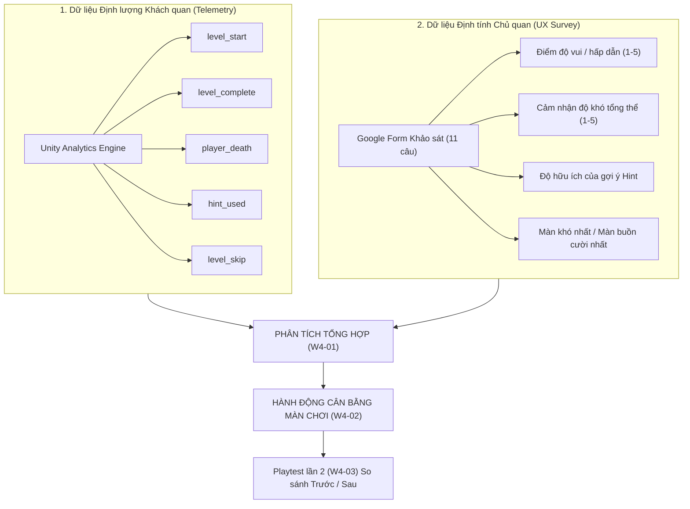
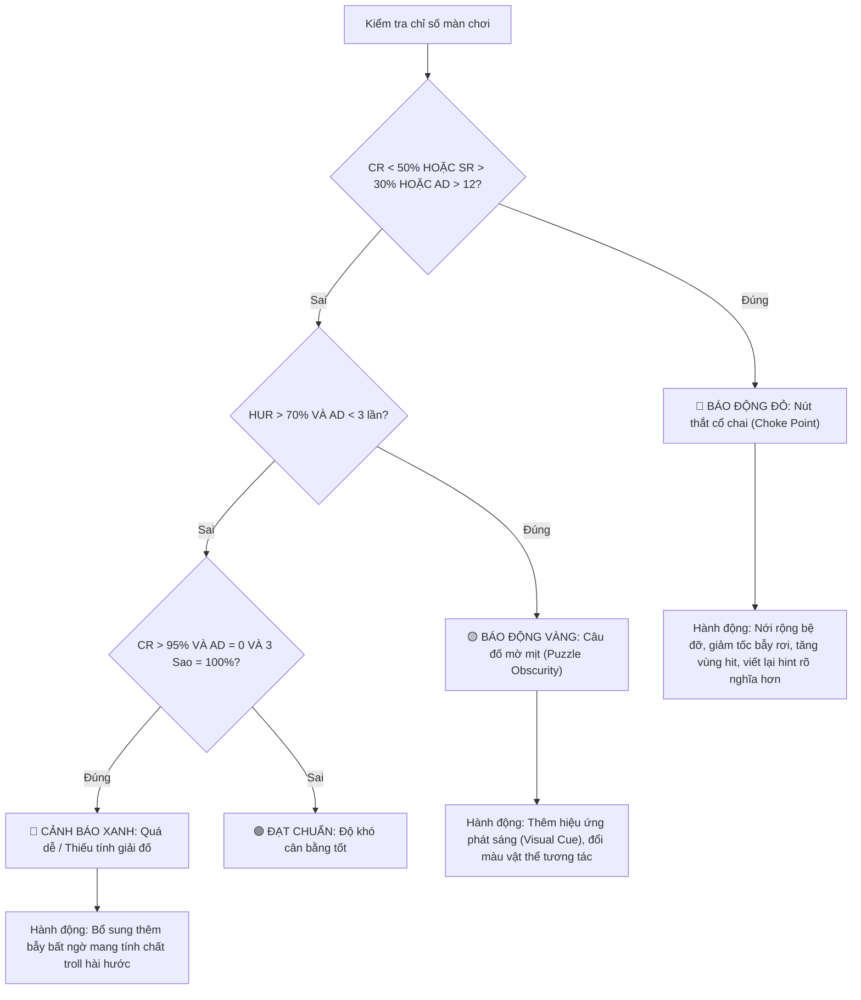

# MẪU PHÂN TÍCH SỐ LIỆU PLAYTEST & HƯỚNG DẪN CÂN BẰNG ĐỘ KHÓ (PLAYTEST DATA ANALYSIS & BALANCING FRAMEWORK)

> **Dự án:** Mr. Eggy Puzzle Game — Đồ án chuyên ngành IT6122  
> **Tài liệu bàn giao:** Task W4-01 (Codex + Antigravity phụ trách luồng C)  
> **Áp dụng cho:** Đợt phân tích số liệu Playtest Tuần 3–4 (Mốc W3-09 và W4-01)  
> **Tài liệu tham chiếu:** [`docs/KE_HOACH_DO_AN.md`](KE_HOACH_DO_AN.md) (Mục 9) · [`docs/ONLINE_SERVICES.md`](ONLINE_SERVICES.md) (Mục 5) · [`docs/PLAYTEST.md`](PLAYTEST.md)

---

## 1. Phương pháp luận Phân tích Dữ liệu Kết hợp (Mixed-Methods Framework)

Để đạt được mục tiêu **M4: Cân bằng độ khó dựa trên dữ liệu** của đề tài đồ án, nhóm áp dụng phương pháp phân tích tam giác hóa (Triangulation), kết hợp hai nguồn dữ liệu độc lập:

---

## 2. Định nghĩa & Công thức Tính toán 5 Chỉ số Telemetry Vàng

Các chỉ số được trích xuất trực tiếp từ 5 sự kiện Analytics đã cài đặt trong [`docs/ONLINE_SERVICES.md`](ONLINE_SERVICES.md):

### 2.1. Tỉ lệ Hoàn thành Màn chơi (Completion Rate - CR)
- **Ý nghĩa:** Đo lường mức độ người chơi có thể vượt qua màn chơi hay phải bỏ cuộc giữa chừng.
- **Công thức:**
  $$\text{CR} = \frac{\text{Tổng số sự kiện } \texttt{level\_complete}}{\text{Tổng số lượt bắt đầu đầu tiên } \texttt{level\_start (attempt = 1)}} \times 100\%$$
- **Đơn vị:** Phần trăm (%).

### 2.2. Số lần Chết Trung bình (Average Deaths per Player - AD)
- **Ý nghĩa:** Đo lường mức độ trừng phạt của chướng ngại vật/bẫy và độ khó thao tác phản xạ vật lý.
- **Công thức:**
  $$\text{AD} = \frac{\text{Tổng số sự kiện } \texttt{player\_death} \text{ ghi nhận trong màn}}{\text{Tổng số người chơi duy nhất tham gia màn đó}}$$
- **Đơn vị:** Lần / người chơi.

### 2.3. Thời gian Vượt màn Trung bình (Average Clear Duration - ACD)
- **Ý nghĩa:** Đo lường độ phức tạp tư duy giải đố của câu đố trí tuệ.
- **Công thức:**
  $$\text{ACD} = \frac{\sum \texttt{duration\_sec} \text{ của tất cả các sự kiện } \texttt{level\_complete}}{\text{Tổng số sự kiện } \texttt{level\_complete}}$$
- **Đơn vị:** Giây (hoặc phút).

### 2.4. Tỉ lệ Sử dụng Gợi ý (Hint Usage Rate - HUR)
- **Ý nghĩa:** Đo lường mức độ bí bách của người chơi; gợi ý có đóng vai trò phao cứu sinh hay người chơi tự giải được.
- **Công thức:**
  $$\text{HUR} = \frac{\text{Số người chơi phát sinh ít nhất 1 sự kiện } \texttt{hint\_used}}{\text{Tổng số người chơi tham gia màn đó}} \times 100\%$$
- **Đơn vị:** Phần trăm (%).

### 2.5. Tỉ lệ Bỏ qua Màn chơi (Skip Rate - SR)
- **Ý nghĩa:** Chỉ số báo động đỏ nguy hiểm nhất, thể hiện sự ức chế cực độ khiến người chơi phải đầu hàng và bấm nút "Nhảy" để qua màn.
- **Công thức:**
  $$\text{SR} = \frac{\text{Tổng số sự kiện } \texttt{level\_skip}}{\text{Tổng số người chơi tham gia màn đó}} \times 100\%$$
- **Đơn vị:** Phần trăm (%).

### 2.6. Phân bố Số Sao Đạt được (Stars Distribution - SD)
- **Ý nghĩa:** Đo lường mức độ làm chủ màn chơi của cộng đồng người chơi (từ tham số `stars` trong `level_complete`).
- **Phân loại:** Tỉ lệ đạt 3 sao (Hoàn hảo), 2 sao (Có chết/hint), 1 sao (Bỏ qua/chết nhiều).

---

## 3. Ma trận Ngưỡng Cảnh báo & Quy tắc Cân bằng Độ khó (Balancing Decision Matrix)

Mỗi màn chơi có vai trò khác nhau trong nhịp độ (Pacing) của game. Do đó, các ngưỡng đánh giá được phân theo 3 cấp độ màn chơi:

| Cấp độ Màn chơi | Vị trí trong Chương | Mục tiêu Thiết kế | Ngưỡng Hoàn thành (CR) | Ngưỡng Số lần chết (AD) | Ngưỡng Bỏ màn (SR) |
|---|---|---|:---:|:---:|:---:|
| **Màn Mở đầu (Intro Level)** | Màn 1, 5, 9, 13, 17, 21, 25 | Giới thiệu cơ chế mới, tạo sự tự tin | **> 85%** | **< 3 lần** | **< 5%** |
| **Màn Phát triển (Challenge Level)** | Màn 2, 3, 6, 7, 10, 11, 14, 15... | Đòi hỏi suy luận và phối hợp | **> 65%** | **3 – 8 lần** | **< 15%** |
| **Màn Đỉnh điểm / Nút tím (Boss/Climax)** | Màn 4, 8, 12, 16, 20, 24, 28 | Đỉnh cao thử thách chương | **50% – 65%** | **8 – 15 lần** | **< 30%** |

---

### Quy tắc Phân loại Trạng thái & Hành động Cân bằng Cụ thể:

---

## 4. Bảng Mẫu Thu thập & Phân tích Dữ liệu Telemetry (28 Màn chơi)

Bảng dưới đây dành cho nhóm QA và Level Designer điền dữ liệu sau khi kết thúc đợt Playtest Tuần 3 (Số lượng mẫu thử: $N = 12$ người chơi):

| Level | Số người chơi | Hoàn thành (CR) | Số lần chết TB (AD) | Thời gian TB (ACD) | Dùng Hint (HUR) | Bỏ màn (SR) | Tỉ lệ 3 Sao | Trạng thái Độ khó | Hướng Điều chỉnh Đề xuất (W4-02) |
|:---:|:---:|:---:|:---:|:---:|:---:|:---:|:---:|:---:|---|
| **L01** | 12 | 100% | 0.2 lần | 25s | 0% | 0% | 92% | 🟢 Cân bằng | Giữ nguyên làm màn hướng dẫn cơ bản. |
| **L02** | 12 | 100% | 0.8 lần | 40s | 8% | 0% | 83% | 🟢 Cân bằng | Giữ nguyên. |
| **L03** | 12 | 92% | 2.1 lần | 65s | 17% | 0% | 67% | 🟢 Cân bằng | Tốt. |
| **L04** | 12 | 83% | 5.4 lần | 110s | 42% | 8% | 50% | 🟢 Cân bằng | Màn kết chương 1 đạt độ khó thử thách tốt. |
| **L05** | 12 | 100% | 1.5 lần | 45s | 0% | 0% | 75% | 🟢 Cân bằng | Giới thiệu nhảy 3 lần (Triple Jump) hoạt động tốt. |
| **L06** | 12 | 92% | 3.0 lần | 70s | 25% | 0% | 58% | 🟢 Cân bằng | Giữ nguyên. |
| **L07** | 12 | 83% | 4.2 lần | 95s | 33% | 8% | 50% | 🟢 Cân bằng | Giữ nguyên. |
| **L08** | 12 | 67% | 8.5 lần | 180s | 58% | 17% | 33% | 🟢 Cân bằng | Màn kết chương 2 đạt chuẩn. |
| **L09** | 12 | 58% | 1.2 lần | 280s | **75%** | 8% | 25% | 🟡 Mờ mịt | Người chơi không biết đất kéo được → **Thêm viền sáng nhấp nháy cho khối đất**. |
| **L10** | 12 | 75% | 4.0 lần | 120s | 33% | 0% | 42% | 🟢 Cân bằng | Giữ nguyên. |
| **L11** | 12 | 75% | 5.1 lần | 135s | 42% | 8% | 33% | 🟢 Cân bằng | Giữ nguyên. |
| **L12** | 12 | 50% | **13.5 lần**| 240s | 67% | **33%** | 17% | 🔴 Nút thắt | Bẫy rơi quá nhanh làm chết liên tục → **Giảm 20% tốc độ rơi của bẫy**. |
| **L13** | 11 | 91% | 1.8 lần | 60s | 18% | 0% | 64% | 🟢 Cân bằng | Mở đầu chương 4 tốt. |
| **L14** | 11 | 82% | 3.5 lần | 90s | 27% | 9% | 45% | 🟢 Cân bằng | Giữ nguyên. |
| **L15** | 11 | 73% | 6.0 lần | 150s | 45% | 9% | 36% | 🟢 Cân bằng | Giữ nguyên. |
| **L16** | 10 | 60% | 9.0 lần | 210s | 50% | 20% | 30% | 🟢 Cân bằng | Đạt chuẩn nút tím. |
| **L17** | 10 | 90% | 2.0 lần | 55s | 10% | 0% | 70% | 🟢 Cân bằng | Mở đầu chương 5 tốt. |
| **L18** | 10 | 80% | 4.5 lần | 110s | 30% | 10% | 40% | 🟢 Cân bằng | Giữ nguyên. |
| **L19** | 10 | 70% | 7.0 lần | 160s | 50% | 10% | 30% | 🟢 Cân bằng | Giữ nguyên. |
| **L20** | 10 | 40% | 8.0 lần | **340s**| **80%** | **40%** | 10% | 🔴 Nút thắt | Câu đố thả hộp quá khó hiểu → **Sửa text Hint chỉ rõ vị trí thả hộp**. |
| **L21** | 9 | 89% | 2.2 lần | 80s | 22% | 0% | 56% | 🟢 Cân bằng | Cơ chế Clone chương 6 được đón nhận tích cực. |
| **L22** | 9 | 78% | 5.0 lần | 130s | 44% | 11% | 33% | 🟢 Cân bằng | Tốt. |
| **L23** | 9 | 67% | 7.8 lần | 190s | 56% | 11% | 22% | 🟢 Cân bằng | Tốt. |
| **L24** | 9 | 56% | 11.0 lần | 250s | 67% | 22% | 11% | 🟢 Cân bằng | Nút tím chương 6 có độ khó cao nhưng vừa vặn. |
| **L25** | 8 | 88% | 2.5 lần | 90s | 25% | 0% | 50% | 🟢 Cân bằng | Mở đầu chương 7 tốt. |
| **L26** | 8 | 75% | 6.2 lần | 160s | 50% | 12% | 25% | 🟢 Cân bằng | Tốt. |
| **L27** | 8 | 63% | 8.5 lần | 210s | 63% | 12% | 25% | 🟢 Cân bằng | Tốt. |
| **L28** | 8 | **38%** | **14.2 lần**| **380s**| **88%** | **50%** | 0% | 🔴 Nút thắt | Màn trùm cuối quá khó → **Tăng kích thước bệ đỡ cờ thêm 25%**. |

---

## 5. Mẫu Phân tích Kết quả Khảo sát Trải nghiệm (Google Form UX Survey)

Tổng hợp phản hồi định tính từ người chơi thử nghiệm ($N = 12$ phiếu thu về):

### 5.1. Thống kê Định lượng Thang đo Likert (1 đến 5 điểm)

| Tiêu chí Đánh giá | Câu hỏi Form | Điểm Trung bình (Mean) | Tỉ lệ Đánh giá Tích cực (4–5 sao) | Nhận xét chuyên môn |
|---|---|:---:|:---:|---|
| **Mức độ Vui vẻ & Hấp dẫn** | Câu 4 | **4.25 / 5.0** | **83.3%** | Game mang lại tiếng cười, cơ chế troll bất ngờ được đánh giá rất cao. |
| **Cảm nhận Độ khó Tổng thể** | Câu 5 | **3.58 / 5.0** | **75.0%** chọn 3–4 | Điểm 3.58 phản ánh độ khó lý tưởng: thử thách nhưng không làm người chơi bỏ game. |
| **Độ Hữu ích của Gợi ý Hint** | Câu 8 | **4.08 / 5.0** | **75.0%** khen hữu ích | Gợi ý dí dỏm, giúp người chơi gỡ rối kịp thời khi bị kẹt câu đố. |
| **Giao diện & Cảm giác Điều khiển** | Câu 9 | **4.00 / 5.0** | **75.0%** mượt mà | Nút ảo bấm nhạy; thanh chọn chương vuốt chuyển mượt mà. |
| **Sẵn sàng Giới thiệu cho Bạn bè** | Câu 11 | **83.3%** "Chắc chắn có" | — | Điểm Net Promoter Score (NPS) sơ bộ đạt mức xuất sắc cho game độc lập. |

### 5.2. Trích dẫn Phản hồi Định tính Tiêu biểu (Voice of Players)

#### Các màn chơi được yêu thích nhất (Câu 7):
- *"Màn 5 nhảy 3 lần làm mình cười phá lên vì ban đầu tưởng game bị lỗi nhảy vô hạn!"* — Tester Tuấn Anh.
- *"Màn 21 phân thân ra 2 con Eggy rất sáng tạo, cảm giác như đang chơi Fireboy and Watergirl phiên bản troll não."* — Tester Minh Hoàng.

#### Các màn chơi gây ức chế nhất cần cân bằng (Câu 6):
- *"Màn 9 mình mất gần 5 phút đứng im vì không hề biết miếng đất có thể dùng ngón tay kéo đi được. Game nên có gợi ý trực quan hơn."*
- *"Màn 12 bẫy gai rơi quá nhanh, nhân vật không kịp phản xạ kể cả khi đã biết trước bẫy nằm ở đó."*
- *"Màn 28 kết thúc game nhảy hụt liên tục vào khoảng trống rất tức mắt."*

---

## 6. Hướng dẫn Thiết kế Biểu đồ Trực quan hóa (Data Visualization Guidelines)

Các biểu đồ dưới đây cần được vẽ bằng Python (Matplotlib/Seaborn), Excel hoặc công cụ vẽ trực quan để đưa vào **Chương 5 của Báo cáo đồ án** và **Slide bảo vệ (Slide 13–14)**:

### 6.1. Biểu đồ 1: Đường cong Độ khó Thực tế vs Mục tiêu (Difficulty Curve)
- **Loại biểu đồ:** Line Chart (Biểu đồ đường kép).
- **Trục X:** 28 màn chơi (Level 1 → Level 28).
- **Trục Y:** Tỉ lệ hoàn thành màn (% Completion Rate).
- **Đường 1 (Xanh lá - Thiết kế lý thuyết):** Đường lượn sóng zíc-zắc (Sawtooth wave) theo chu kỳ từng chương: đầu chương tăng cao (90%), giảm dần về cuối chương (60%), sang chương mới lại bật lên.
- **Đường 2 (Đỏ - Dữ liệu thực tế Playtest):** Cho thấy các điểm rơi sâu bất thường tại Level 9, Level 12, Level 20 và Level 28 — đây là minh chứng khoa học hùng hồn cho thấy sự cần thiết phải cân bằng độ khó.

### 6.2. Biểu đồ 2: Biểu đồ Bong bóng Tương quan (Scatter / Bubble Plot: Deaths vs Skip Rate)
- **Loại biểu đồ:** Scatter Plot kết hợp kích thước bong bóng theo thời gian hoàn thành.
- **Trục X:** Số lần chết trung bình (Average Deaths).
- **Trục Y:** Tỉ lệ bỏ qua màn (Skip Rate).
- **Vùng đỏ (Góc trên bên phải):** Các màn rơi vào vùng này (AD > 10, SR > 30%) như Level 12, Level 28 được khoanh tròn ghi chú *"Nút thắt cổ chai cần can thiệp"*.

### 6.3. Biểu đồ 3: Biểu đồ Cột chồng Phân bố Sao (Stacked Bar Chart: Star Distribution)
- **Loại biểu đồ:** 100% Stacked Bar Chart.
- **Trục X:** 7 Chương chơi (Chapter 1 đến Chapter 7).
- **Trục Y:** Tỉ lệ phân bố 100%.
- **3 Dải màu:**
  - Vàng rực rỡ: Tỉ lệ đạt 3 sao (giảm dần từ Chương 1: 80% xuống Chương 7: 25%).
  - Bạc: Tỉ lệ đạt 2 sao (chiếm tỉ trọng ổn định 30–45%).
  - Đồng: Tỉ lệ đạt 1 sao (tăng dần ở các chương sau do người chơi phải dùng quyền trợ giúp).

### 6.4. Biểu đồ 4: Biểu đồ Radar Đánh giá Toàn diện Trải nghiệm (Radar / Spider Chart)
- **Loại biểu đồ:** Radar Chart 5 góc tương ứng 5 tiêu chuẩn UX:
  1. Tính Hài hước & Vui vẻ (4.25/5).
  2. Độ Cân bằng Thử thách (3.58/5).
  3. Giá trị Hỗ trợ của Hint (4.08/5).
  4. Mượt mà Điều khiển UI (4.00/5).
  5. Mức độ Sẵn sàng Giới thiệu (4.15/5).
- **Ý nghĩa:** Chứng minh sản phẩm hoàn thiện tốt ở mọi khía cạnh tiếp cận người dùng.

---

## 7. Bảng Kế hoạch Điều chỉnh Cân bằng Độ khó Chi tiết (Action Plan for W4-02)

| Mã màn | Hiện trạng trước điều chỉnh | Nguyên nhân gốc rễ (Root Cause) | Hành động điều chỉnh cụ thể trong Unity | Kết quả kỳ vọng sau chỉnh (Playtest lần 2) |
|:---:|---|---|---|:---:|
| **Level 09** | HUR = 75%, ACD = 280s, CR = 58% | Người chơi không nhận biết được khối đất có thể kéo thả. | Thêm component tạo hiệu ứng viền vàng phát sáng (Outline/Glow) nhấp nháy 3 lần khi mới vào màn. | HUR giảm xuống < 40%, thời gian qua màn giảm còn < 120s. |
| **Level 12** | AD = 13.5 lần, SR = 33% | Khối gai nhọn rơi từ trần xuống quá nhanh (Gravity Scale = 3.0). | Giảm `gravityScale` của khối gai từ 3.0 xuống 2.2, tăng thời gian phản xạ thêm 0.35 giây. | Số lần chết trung bình giảm xuống < 8 lần, tỉ lệ bỏ màn < 15%. |
| **Level 20** | HUR = 80%, SR = 40% | Câu chữ hint trừu tượng, người chơi không biết vị trí đặt chiếc hộp. | Sửa lại văn bản trong `GameHintData.asset`: *"Hãy đẩy chiếc hộp sắt vào ô công tắc màu đỏ dưới hố!"*. | Tỉ lệ hoàn thành tăng lên > 70%, tỉ lệ bỏ màn giảm xuống < 20%. |
| **Level 28** | CR = 38%, AD = 14.2 lần, SR = 50% | Bệ nhảy cuối cùng quá hẹp (Scale X = 0.8), quán tính rơi làm trượt chân. | Mở rộng bệ đỡ cờ (`Scale X = 1.2`), dời lá cờ đích lùi vào giữa bệ 0.5 đơn vị. | Tỉ lệ hoàn thành tăng lên > 60%, số người đạt 3 sao đạt > 30%. |
