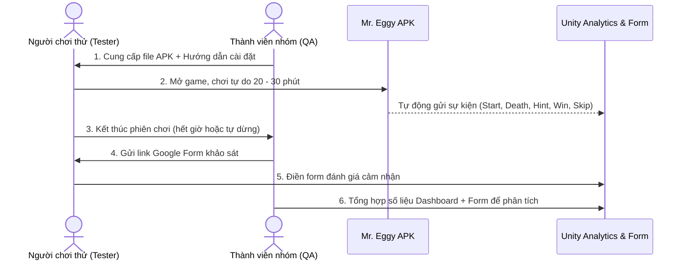

# KỊCH BẢN PLAYTEST & BIỂU MẪU THU THẬP SỐ LIỆU NGƯỜI CHƠI

> **Dự án:** Mr. Eggy Puzzle Game — Đồ án chuyên ngành IT6122  
> **Người thực hiện:** Agent Antigravity (QA Lead)  
> **Áp dụng cho:** Đợt Playtest Tuần 3 (Mốc W3-09: 06/11 – 09/11)  
> **Tài liệu tham chiếu:** Mục 9 kế hoạch đồ án ([`docs/KE_HOACH_DO_AN.md`](KE_HOACH_DO_AN.md#9-kế-hoạch-playtest--thu-thập-số-liệu))

---

## 1. Mục tiêu & Nguyên tắc tổ chức Playtest

### 1.1. Mục tiêu
- Đánh giá trải nghiệm thực tế (UX) của người chơi khi tương tác với trò chơi trên các dòng điện thoại Android khác nhau.
- Đo lường và phát hiện các màn chơi "nút thắt cổ chai" (màn chơi có tỷ lệ chết bất thường, tỷ lệ bỏ màn cao hoặc thời gian vượt màn quá lâu).
- Thu thập dữ liệu định lượng (thông qua Unity Analytics) và định tính (thông qua Google Form) để làm căn cứ khoa học cho việc **Cân bằng độ khó (Task W4-02)**.

### 1.2. Đối tượng tham gia
- Số lượng: Tối thiểu **10 đến 15 người chơi**.
- Thành phần: Bạn bè cùng lớp, sinh viên trường khác, người thân có hoặc chưa có kinh nghiệm chơi game giải đố trí tuệ (Brain Out, Troll Face Quest). Yêu cầu chưa từng xem qua mã nguồn hay bản thiết kế của game.

### 1.3. Nguyên tắc quan sát ("Câm lặng là vàng")
- Người hướng dẫn (thành viên nhóm) **tuyệt đối không được chỉ dẫn, gợi ý cách giải** trong suốt phiên chơi của người tham gia.
- Không can thiệp khi người chơi bị chết liên tục hoặc tỏ ra bối rối; hãy quan sát nét mặt, ngôn ngữ cơ thể và ghi chú lại thời điểm người chơi nản lòng hoặc bật cười thích thú.

---

## 2. Quy trình tổ chức từng bước (Step-by-Step Protocol)

### Bước 1: Chuẩn bị & Cài đặt APK (5 phút)
1. Gửi file `MrEggy_Beta_v0.9.apk` cho người chơi qua Zalo / Google Drive.
2. Hướng dẫn người chơi bật tính năng: *"Cho phép cài đặt ứng dụng từ nguồn không xác định"* trên Android.
3. Đảm bảo thiết bị có kết nối mạng Internet (Wi-Fi hoặc 4G) để hệ thống gửi dữ liệu telemetry.

### Bước 2: Phiên chơi tự do (Free-play Session: 20 – 30 phút)
1. Đặt đồng hồ bấm giờ 25 phút.
2. Người chơi bắt đầu từ `Level 1` và tự do trải nghiệm theo tốc độ cá nhân:
   - Được quyền dùng gợi ý (Hint) nếu muốn.
   - Được quyền dùng tính năng bỏ qua màn ("Nhảy").
   - Được dừng chơi bất cứ khi nào cảm thấy quá ức chế hoặc đã hết thời gian.
3. Thành viên QA ghi chép nhật ký quan sát vào biểu mẫu bên dưới.

### Bước 3: Thu thập phản hồi qua Form & Phỏng vấn nhanh (5 phút)
1. Gửi đường link Google Form khảo sát ngay khi kết thúc phiên chơi.
2. Đặt thêm 1-2 câu hỏi phỏng vấn nhanh: *"Màn nào làm bạn thấy bất ngờ và buồn cười nhất?"*, *"Có chỗ nào bạn bấm mà game không phản hồi như mong đợi không?"*.

---

## 3. Nội dung Biểu mẫu Google Form Khảo sát (Survey Questions)

Dưới đây là nội dung chi tiết để nhập trực tiếp vào Google Forms:

### Phần 1: Thông tin người tham gia
- **Câu 1:** Họ và tên (hoặc Biệt danh): *[Câu trả lời ngắn]*
- **Câu 2:** Dòng điện thoại bạn đang sử dụng (Ví dụ: Samsung Galaxy A52, Xiaomi Redmi Note 11, Oppo Reno...): *[Câu trả lời ngắn]*
- **Câu 3:** Bạn có thường chơi thể loại game giải đố / troll não (Brain Out, Brain Test, Troll Face...) không?
  - `( )` Thường xuyên chơi
  - `( )` Thỉnh thoảng chơi
  - `( )` Hiếm khi / Chưa từng chơi

---

### Phần 2: Đánh giá trải nghiệm Gameplay & Độ khó (Thang điểm Likert 1 – 5)
- **Câu 4:** Mức độ vui vẻ, lôi cuốn của trò chơi:
  - *Thang đo:* `1` (Rất chán / Tẻ nhạt) → `5` (Rất vui / Hài hước / Cuốn hút)
- **Câu 5:** Đánh giá độ khó tổng thể của các màn chơi bạn đã trải qua:
  - *Thang đo:* `1` (Quá dễ) → `2` (Hơi dễ) → `3` (Vừa vặn, thử thách tốt) → `4` (Khá khó) → `5` (Quá khó / Ức chế)
- **Câu 6:** Màn chơi nào bạn thấy **KHÓ NHẤT** hoặc làm bạn bị kẹt lâu nhất? Hãy ghi rõ số Level và lý do vì sao bạn không qua được?
  - *[Đoạn văn tự do]*
- **Câu 7:** Màn chơi nào bạn thấy **ẤN TƯỢNG VÀ BẤT NGỜ NHẤT**?
  - *[Đoạn văn tự do]*

---

### Phần 3: Giao diện & Tính năng hỗ trợ
- **Câu 8:** Hệ thống gợi ý (Bóng đèn Hint) có hữu ích đối với bạn không?
  - `( )` Rất hữu ích, gợi ý thông minh và hài hước
  - `( )` Tạm được, đủ để hiểu cách giải
  - `( )` Không hữu ích, gợi ý quá khó hiểu hoặc vô dụng
  - `( )` Tôi không dùng gợi ý lần nào
- **Câu 9:** Giao diện điều khiển (nút bấm Trái/Phải/Nhảy) và thanh chọn chương ở menu có dễ thao tác không?
  - *Thang đo:* `1` (Rất khó bấm / Lệch tay) → `5` (Rất mượt mà, dễ bấm)
- **Câu 10:** Bạn có gặp bất kỳ lỗi hình ảnh, tụt khung hình (giật lag) hay lỗi hiển thị nào không?
  - *[Đoạn văn tự do]*
- **Câu 11:** Bạn có sẵn sàng giới thiệu tựa game này cho bạn bè hoặc muốn chơi tiếp các chương sau không?
  - `( )` Chắc chắn có
  - `( )` Có thể
  - `( )` Không

---

## 4. Bảng chỉ số Telemetry từ Analytics & Ngưỡng kích hoạt Cân bằng

Dữ liệu tự động đẩy về hệ thống Unity Analytics sẽ được trích xuất để tính toán 5 chỉ số vàng cho từng màn chơi:

| Mã Chỉ số | Tên chỉ số | Công thức tính toán | Ngưỡng báo động (Cần cân bằng lại) | Hành động khắc phục tương ứng |
|:---:|---|---|:---:|---|
| **KPI-01** | **Tỉ lệ hoàn thành màn** (Completion Rate) | `Số lần level_complete / Số lần level_start` | **< 60%** | Màn quá khó hoặc bẫy bất hợp lý -> Cần dời vị trí bẫy xa hơn hoặc tăng thêm thời gian phản xạ. |
| **KPI-02** | **Số lần chết trung bình** (Average Deaths) | `Tổng player_death / Tổng số người chơi màn` | **> 10 lần / người** | Màn gây ức chế cao -> Bổ sung thêm bệ đỡ an toàn hoặc giảm tốc độ của bẫy rơi. |
| **KPI-03** | **Thời gian trung bình qua màn** (Average Duration) | `Trung bình duration_sec của các lượt level_complete` | **> 5 phút (300s)** | Câu đố quá rối rắm -> Tinh chỉnh lại câu chữ gợi ý trong Hint rõ ràng hơn. |
| **KPI-04** | **Tỉ lệ lạm dụng gợi ý** (Hint Usage Rate) | `Số lần hint_used / Tổng số người chơi màn` | **> 70%** | Người chơi không thể tự tìm ra quy luật logic -> Thiết kế thêm tín hiệu trực quan (Visual Cue). |
| **KPI-05** | **Tỉ lệ bỏ cuộc qua màn** (Skip Rate) | `Số lần level_skip / Tổng số người chơi màn` | **> 30%** | Màn chơi bị coi là "vô lý" -> Cân nhắc làm lại cấu trúc câu đố của màn đó. |

---

## 5. Mẫu Phiếu ghi chú quan sát trực tiếp (Dành cho QA Tester)

Thành viên nhóm in hoặc ghi chú nhanh vào bảng này khi quan sát người chơi:

| Người chơi (Tester) | Màn chơi bắt đầu / kết thúc | Tổng số màn đã vượt qua | Màn bị kẹt lâu nhất | Phản ứng nổi bật (Cười, bực mình, ngạc nhiên...) | Ghi chú kỹ thuật (FPS, viền đen màn hình...) |
|---|:---:|:---:|:---:|---|---|
| *Nguyễn Văn A* | Level 1 → Level 12 | 12 | Level 9 (Kéo đất) | Không biết đất kéo được, mất 4 phút mới nhận ra. | Máy Xiaomi tai thỏ, SafeArea hiển thị rất tốt. |
| *Trần Thị B* | Level 1 → Level 8 | 8 | Level 5 (Triple Jump) | Bất ngờ khi thấy nhân vật nhảy được 3 lần. | Khung hình mượt 60 FPS. |
